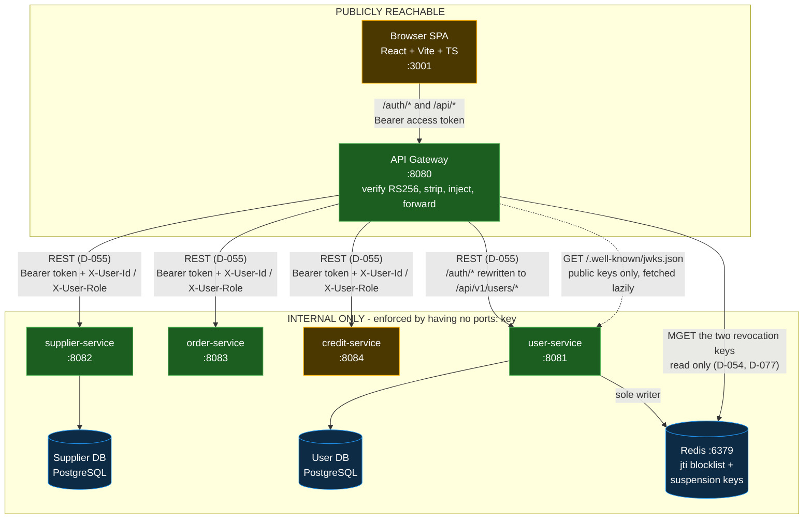
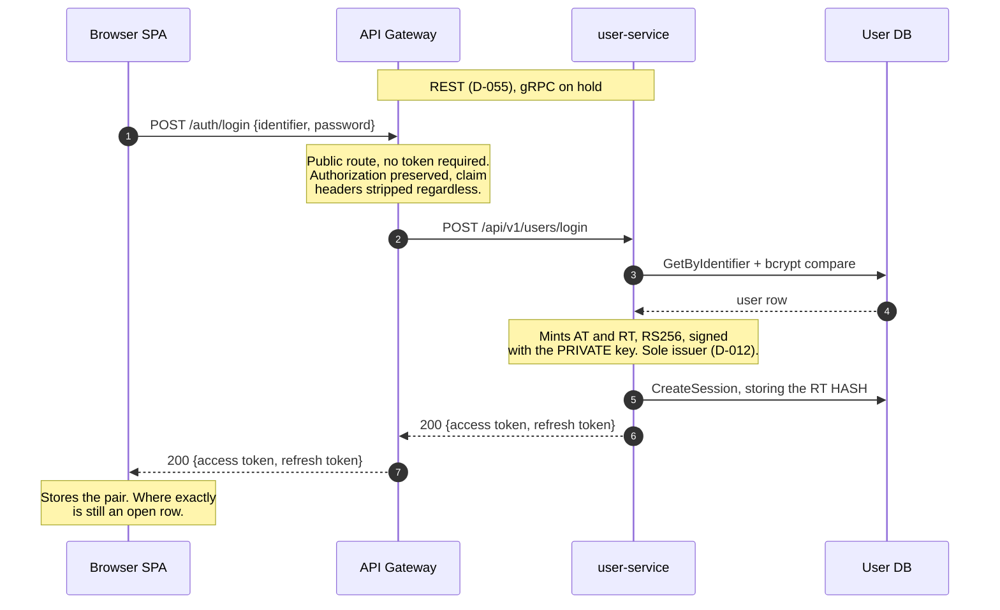
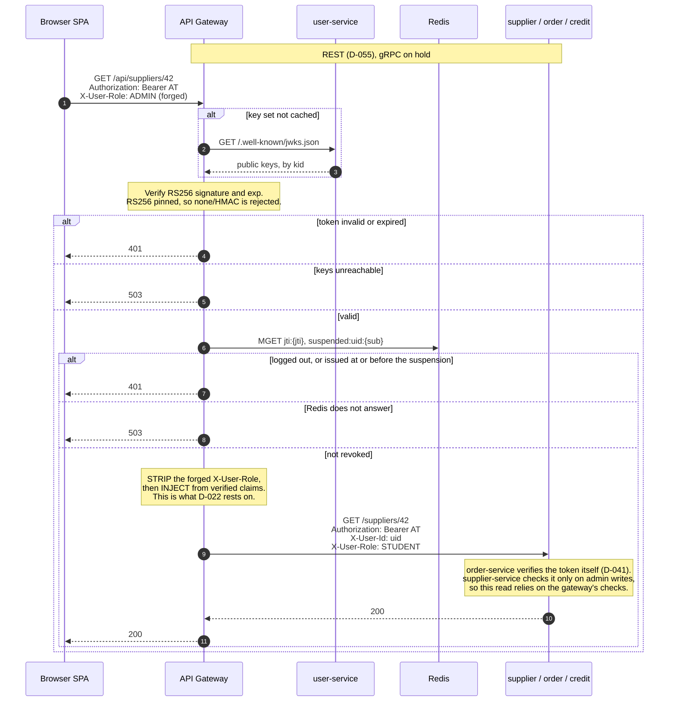
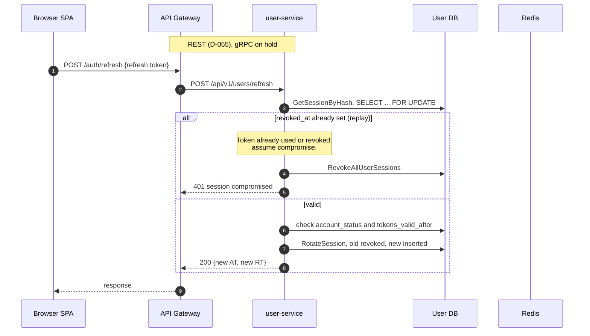
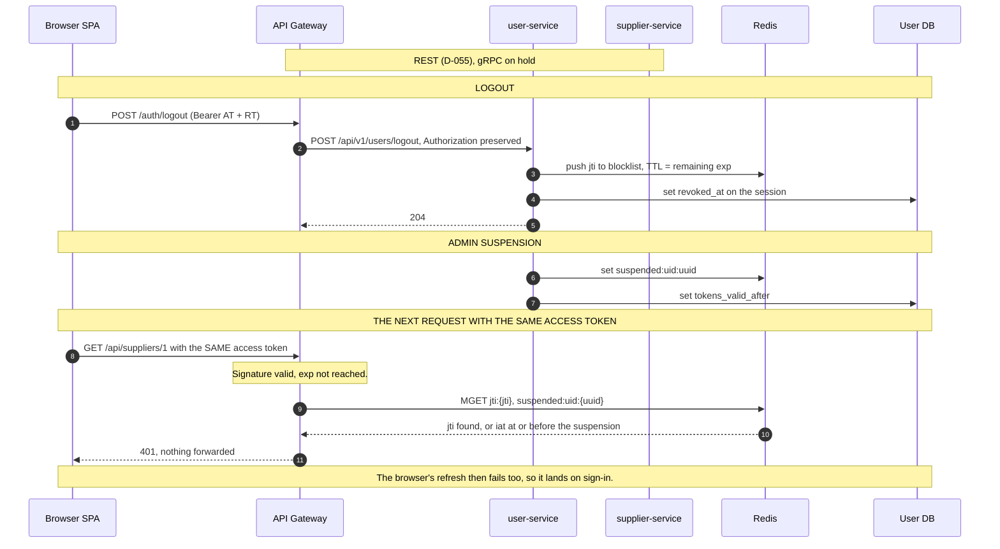
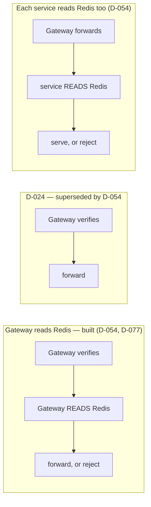

<!--
AI Assistance Disclosure:
Tool: Claude Code (model: Opus 5), date: 2026-09-19
Scope: Redrew the team's PNG architecture diagram as Mermaid and brought it in
  line with decisions D-019..D-028. Every element traces to a recorded row in
  ../decisions.md — no architecture was invented here, and no Rationale is
  offered.
  2026-09-22: corrected two errors (refresh read Postgres not Redis; the
  lingering-token arrow goes to supplier-service not user-service), added §6
  on who answers "is this token still good?", refreshed §7's state table.
Author review: Nigeltzy - The AI was use dto convert the team's original PNG diagram into mermaid for easier recording and updating on the repo.
-->

# FoC — Architecture

Supersedes [`jwt-token-architecture-diagram.png`](jwt-token-architecture-diagram.png)
as the current picture. **The PNG is kept deliberately**: it is what the team
drew on 2026-09-19 and what D-010–D-018 were transcribed from. The decisions
once departed from it in two places, both flagged below, and D-054 has since
brought both back in line with it.

Mermaid rather than an image so it renders on GitHub, diffs in review, and
cannot silently drift from the decisions it depicts.

Every box and arrow traces to a row in [`../decisions.md`](../decisions.md).
Where something is **not built yet**, the diagram says so rather than showing an
intention as though it were a system.

---

## 1. Trust zones and components

| Colour | Meaning | Components |
| --- | --- | --- |
| Green | Built and on `main` | `api-gateway`, `user-service`, `supplier-service`, `order-service` |
| Amber | Partly built | Browser SPA (the errand and credit screens still use mocks until PR #40), `credit-service` (a scaffold on `main`; the service is in PR #44) |
| Red, dashed | Folder exists, no code | none |

> **Changed from the PNG (1 of 2), then back.** The original attached Redis to
> the API Gateway. **D-024 took the gateway out of Redis entirely**, leaving
> `user-service` as the only process that touched it. **D-054 put the gateway
> back as a reader** (built as D-077): it reads the two revocation keys on every
> authenticated request, and `user-service` is still their only writer.

---

## 2. Login and registration (D-012, D-015, D-023, D-027)

The gateway mints, inspects and stores nothing here. It rewrites the path and
passes the response back.

---

## 3. An authenticated request (D-022, D-054, D-055, D-077)

The forged `X-User-Role: ADMIN` arrives at the service as `STUDENT`.
`TestClientCannotEscalateViaHeader` exists to keep it that way.

---

## 4. Refresh (D-015)

**Revocation bites here:** a logged-out or suspended user cannot renew a
session. The gateway takes no part in this decision; it only carries the
request. It refuses the revoked access token itself on every other request
(§3).

> **Corrected 2026-09-22.** This diagram previously showed `user-service`
> reading the Redis blocklist here. It does not. `RefreshService.activeAccount`
> reads `account_status` and `tokens_valid_after` from **PostgreSQL**, and the
> replay check above reads the session row. `user-service`'s Redis adapter is
> `RedisBlocklistWriter`, whose interface is `Set` only — there is no `Get`
> anywhere in the service. See §5.

---

## 5. Logout and suspension (D-054, D-077)

> **Changed from the PNG (2 of 2), then back.** The original says logout makes
> the access token *"stop working before its exp"*. Under **D-024** it did not,
> because nothing on the request path read the blocklist, and **D-025a**
> accepted that for the prototype. **D-054 superseded both**: the gateway reads
> the blocklist and the suspension key on every authenticated request (D-077),
> so the token stops working at once, as the PNG said.

> **Updated 2026-10-20.** The 2026-09-22 note here said both keys had no reader
> anywhere. They now have three: the gateway on every authenticated request,
> and order-service and supplier-service on their own routes (§6). Revocation
> is still enforced at **refresh** as well, from PostgreSQL, as §4 shows.

> **Corrected 2026-09-22.** The last arrow previously went to `user-service`.
> A request for `/api/suppliers/1` is proxied straight to `supplier-service`;
> `user-service` is on the path only for `/auth/*` and `/api/users/*`.

---

## 6. Who answers "is this token still good?"

Added 2026-09-22, because this is the question the repo keeps disagreeing with
itself about. Two different jobs get called "validating a token":

| | Question | Needs | Who does it today |
| --- | --- | --- | --- |
| **Job 1** | Is this token genuine and unexpired? | The issuer's **public** key, and nothing else | **The API Gateway**, locally, on every request; order-service and supplier-service's admin writes check it again (D-041) |
| **Job 2** | Has it been killed early — logout, suspension? | **Shared state** (the Redis keys) | **The API Gateway**, on every authenticated request (D-077); order-service and supplier-service also check on their own routes |

Job 1 needs no network call. Access tokens are RS256 (D-023): `user-service`
holds the private key and is the only process that can mint one (D-012); the
gateway holds only the public key, fetched once from `/.well-known/jwks.json`
and cached. Verifying is arithmetic.

Job 2 cannot be answered from the token. A logged-out access token is
byte-for-byte valid until its `exp`. Answering it means reading state that
something else wrote.

**Three models have been described. A is what is built.**

**A** is what the PNG, the team's Mermaid step 8 and `user-service/AGENTS.md`
("*If the Gateway cannot reach Redis … the request must be rejected*")
describe, and what the gateway does since D-077: a revoked token gets 401, and
when Redis does not answer it fails closed with 503. **B** was the state under
D-024 until D-054 superseded it. **C** is D-054's other half: order-service and
supplier-service check the keys themselves, and user-service's own routes and
credit-service are still to. With A in place, C is defence in depth.

### Who reads the Redis keys

| Key | Written by | Read by |
| --- | --- | --- |
| `jti:<jti>` | `user-service` on logout (`BlockAccessToken`) | the API Gateway, `order-service`, `supplier-service` |
| `suspended:uid:<uuid>` | `user-service` on suspension (`WriteSuspension`) | the API Gateway, `order-service`, `supplier-service` |

`user-service` is still their only writer (D-054). The gateway reads them with
one `MGET` per authenticated request, bounded at 500 ms
(`api-gateway/internal/revocation`), and nothing in the gateway binary writes
to Redis.

### Revocation is also enforced at refresh, from PostgreSQL

`RefreshService.activeAccount` checks `account_status` and
`tokens_valid_after`, and the replay check reads the session row's
`revoked_at`. All PostgreSQL, no Redis. So a logged-out or suspended user
**cannot renew a session** either. Before D-054, the access token already in
the browser kept working until its `exp`, up to 15 minutes (D-025a); the
gateway's check now refuses it at once.

### F1.7.2 and D-025a

**F1.7.2** in the product backlog says sessions terminate *upon* suspension.
**D-025a** said up to 15 minutes later. D-054 superseded D-025a and the reader
is built (D-077), so F1.7.2 holds. One gap is left: the gateway accepts a token
up to 5 s past its `exp` (clock skew), and a revocation key can expire at about
that `exp`, so a revoked token can pass for those 5 s until user-service keeps
each key 5 s longer.

---

## 7. Where the code actually is, today

Refreshed 2026-10-20.

| Component | State | Branch |
| --- | --- | --- |
| `api-gateway` | **Working.** Verifies tokens against the JWKS and checks the revocation keys; unit, router and Redis integration tests | `main` |
| Browser SPA | **Working through the gateway** for sign-in, profile, admin and suppliers; the errand and credit screens still use mocks until PR #40 | `main` |
| `supplier-service` | **Working.** Verifies the token and the revocation keys itself on admin writes, and ignores `X-User-Role` | `main` |
| `user-service` | **Working.** RS256/JWKS issuer, register with email OTP, login/refresh/logout, profile, suspension, default admin, `user.registered` events | `main` |
| `order-service` | **Working.** The errand lifecycle; verifies tokens and the revocation keys itself | `main` |
| `credit-service` | Scaffold on `main`; the service is in PR #44 | `feat/initial-credit` |
| `notification-service` | No folder, no owner, no decision row | — |
| Redis | In `compose.yaml`; written by `user-service`, read by the gateway, `order-service` and `supplier-service` (§6) | `main` |

## 8. What this picture assumes, and does not yet have

- **The strip-and-inject rule is not recorded.** It is specified only in a
  `user-service/AGENTS.md` that is on no branch. The team chose to build against
  it anyway — an exception to §1, noted above the Open table in
  [`../decisions.md`](../decisions.md).
- **The gateway's unit tests mint their own RS256 tokens** against a stub JWKS;
  the `e2e/` suite runs it against the real `user-service`.
- **AWS deployment is undecided** (D-009). The private VPC this trust model
  assumes has no decision and no code behind it.
