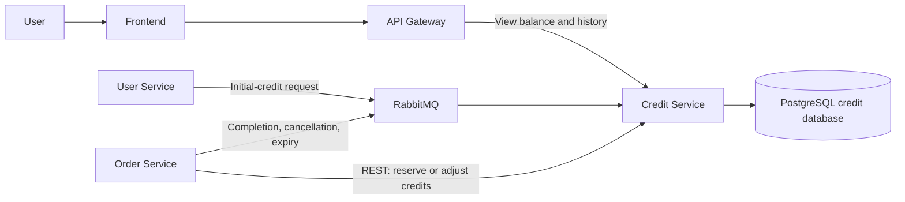
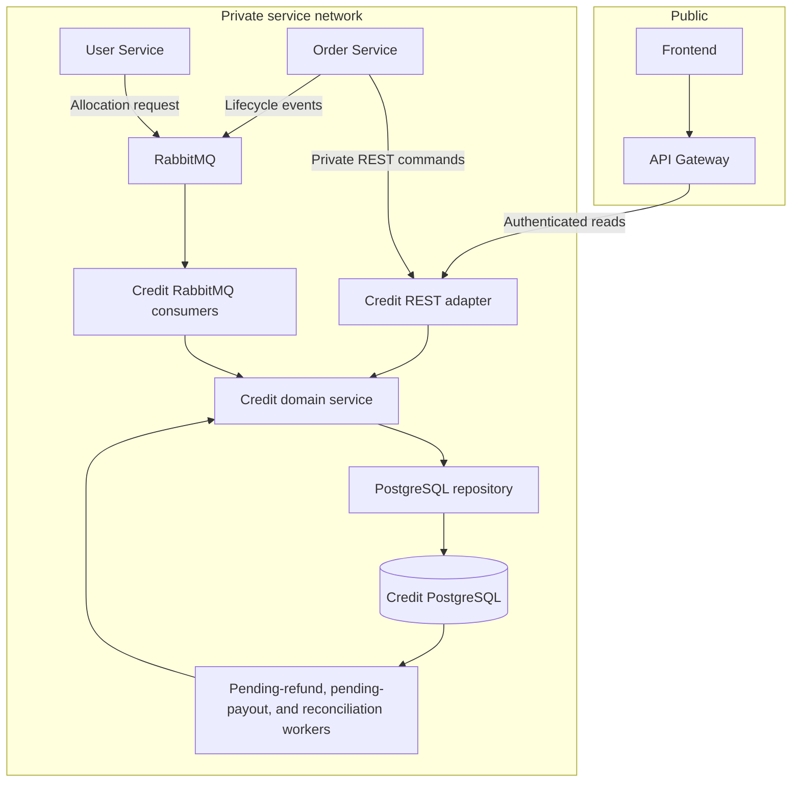

# Credit Service Source of Truth

This document is the source of truth for the Credit Service only. It defines the
Credit Service's responsibilities, data, interfaces, behavior, implementation
plan, and the external guarantees on which it depends. References to User
Service, Order Service, frontend, API Gateway, RabbitMQ, or shared infrastructure
describe integration boundaries; they do not expand the Credit Service
implementation scope. Work owned by another service is explicitly separated and
must be planned and implemented by that service's owner.

The other Markdown files in this directory are retained as historical decision
records only. They are not implementation contracts and may contain superseded
information. If any of them differs from this document, this document takes
precedence.

## Business Problem

The platform needs a reliable way to manage the credits that requesters offer
and couriers earn for completing errands. Credits must be reserved when an
errand is created, returned when it is cancelled or expires, and transferred to
the courier at most once when it is completed. Under the documented producer
and infrastructure assumptions, an accepted outcome is processed eventually.
Users must be able to trust that
their available and reserved balances are accurate and that every change can be
traced. The Credit Service provides this single source of truth while ensuring
that credits cannot be duplicated, lost, purchased, withdrawn, or changed
arbitrarily.

## Big Components and How They Fit Together

The **User Service** manages user registration. After a user registers, it asks
the Credit Service through **RabbitMQ** to create the user's credit account and
provide the initial 100 credits. RabbitMQ carries this work in the background,
so registration and login do not have to stop while the credit account is being
prepared.

The **Order Service** manages errands and decides when they are created,
edited, completed, cancelled, or expired. It calls the Credit Service directly
over **REST** when credits must be reserved or when an open errand's reward is
changed. It sends completed, cancelled, expired, and failed outcomes through
RabbitMQ so the Credit Service can pay the courier or return the requester's
reserved credits.

The **Credit Service** applies the financial consequences of those actions. Its
business rules prevent overspending, duplicate payouts, and repeated refunds.
Its **PostgreSQL database** stores current balances, one financial reservation
per errand, and a permanent history of every credit change.

The **frontend** reaches the Credit Service through the **API Gateway** to show
the signed-in user their available credits, reserved credits, and transaction
history. The API Gateway is the public entry point; the Credit Service itself
remains inside the private service network.

In short, the User Service says when a credit account should be created, the
Order Service says what happened to an errand, and the Credit Service is the
only component allowed to decide how those facts change credit balances.

## Finished Credit Service Behavior

When this plan is complete, the Credit Service will be the platform's single
financial authority for credits. It will maintain each user's available and
reserved balances, one current financial reservation for each errand, and an
application-append-only ledger from which those balances can be reconstructed. Except for the
one-time initial allocation for a newly registered user, every operation will
only move existing credits; it will never purchase, withdraw, mint, destroy, or
arbitrarily edit them.

The finished service will support the following behavior:

- **Initial allocation:** after User Service reports a new registration through
  RabbitMQ, Credit Service creates that user's wallet with 100 available
  credits. Processing the same registration more than once will not allocate
  credits twice. Registration itself remains asynchronous, so a newly created
  user may temporarily see that their wallet is still being prepared.
- **Balance and history reads:** an authenticated user can view only their own
  available balance, reserved balance, and paginated transaction history through
  the API Gateway. The history identifies the errand and financial operation
  associated with each movement where applicable. If reconciliation flags the
  account, the user can still see a temporary-unavailability status and their
  history, but Credit Service withholds the untrusted balance amounts.
- **Reservation creation:** Order Service can ask Credit Service over private
  REST to reserve an amount for an errand. Credit Service rejects missing
  wallets and insufficient available credits; otherwise it atomically moves the
  amount from available to reserved and records one reservation for the
  `errandId`. While the order remains `PENDING`, an identical retry returns the
  existing result without deducting credits again, while conflicting requester
  or amount details are rejected. After reservation success, Order Service must
  stop issuing creation requests for that errand.
- **Reward adjustment:** while Order Service permits an errand to be edited, it
  can synchronously request a change from the reservation's stated
  `currentAmount` to a `newAmount`. Credit Service checks that the stated amount
  matches its stored reservation, reserves an increase or releases a decrease,
  updates the same reservation row, and appends the changes to the ledger. A
  mismatch reports Credit Service's current amount without changing balances.
- **Cancellation, expiry, or terminal failure:** after receiving one of these
  lifecycle outcomes through RabbitMQ, Credit Service returns the reservation's
  current stored amount from reserved to available and marks the reservation
  `REFUNDED`. Duplicate delivery has no additional effect. If an integrity flag
  blocks the refund, Credit Service stores durable pending-refund work and
  leaves it pending. It can complete after a separately authorized repair, but
  version 1 defines no repair interface and therefore does not promise eventual
  recovery from an integrity flag.
- **Completion payout:** after receiving a completion containing the
  `errandId` and `courierId`, Credit Service reads the requester and amount from
  its own reservation, removes that amount from the requester's reserved
  balance, credits the courier's available balance, and marks the reservation
  `PAID_OUT`. The transfer happens atomically and at most once. The `errandId`
  is the business idempotency key: after the reservation is `PAID_OUT`, any
  later completion for that errand is acknowledged without another transfer.
  A completion naming the requester as courier is rejected without changing
  credits.
- **Delayed courier payout:** if the courier's wallet is missing, either account
  is flagged, or crediting the courier would exceed the available-bucket limit,
  Credit Service keeps the requester's credits reserved and stores the payout
  as pending. It retries after the blocking condition changes. A payout that
  remains pending beyond the configured threshold writes an overdue structured
  log. Version 1 has no external paging or alert-delivery backend.
- **Duplicate and conflicting messages:** repeated valid commands and events are
  handled idempotently. A completion after refund, refund after payout,
  malformed message, or other lifecycle-contract violation detected before
  settlement makes no financial change and is retained for investigation rather
  than retried forever. Once a reservation is terminal, later events covered by
  its `errandId` idempotency rule may instead be acknowledged as duplicates as
  described in the refund and payout phases.
- **Failure isolation and reconciliation:** Credit Service periodically checks
  account projections and reservation state against the application-append-only ledger. If it
  finds a discrepancy, it flags the affected account and blocks only
  credit-changing operations involving that account. Unrelated users continue
  normally. It reports the expected values for investigation but does not
  automatically edit balances or ledger history.
- **Operational recovery:** temporary RabbitMQ-processing failures receive a
  bounded number of retries. Messages that are malformed, violate the lifecycle
  contract, or exhaust their retries are preserved in the appropriate
  dead-letter queue for investigation. Lifecycle events may be deliberately
  replayed under the procedure below; registration allocation requests require
  a fresh attempt from User Service and are not replayed by Credit Service.

The finished Credit Service will not decide whether an errand may be created,
edited, completed, cancelled, or expired. Those lifecycle decisions remain with
Order Service. It will also not validate users, create wallets opportunistically
during payout, expose internal financial commands through the API Gateway, or
provide general administrator balance editing and reversal features.

## Ideas Considered and Ruled Out

The following approaches were discussed and deliberately rejected. They are
recorded here so that future changes do not accidentally reintroduce them
without a new team decision.

### Make registration wait for the Credit Service

We considered creating the credit account before finishing registration, or
keeping the user inactive until the initial 100 credits were allocated. This
was rejected because a Credit Service outage would prevent registration or
login. Users are created as active, initial allocation happens in the
background, and only credit-dependent actions wait for wallet readiness.

### Let the Credit Service create wallets during payout

We considered having the Credit Service ask whether a courier exists and create
the courier's wallet when a payout arrived. This was rejected because user
existence and registration belong to the User Service. If a courier's wallet is
not ready, the payout waits for the normal initial-allocation workflow instead.

### Require wallet readiness before a courier accepts an errand

We considered blocking a courier from accepting errands until their credit
account was ready. This was rejected because a temporary allocation delay
should not stop an otherwise valid user from acting as a courier. If necessary,
the completed payout remains pending and is paid at most once after the wallet
becomes ready.

### Keep a credit database transaction open while Order Service creates an order

We considered a prepare-and-confirm flow where Credit Service would hold an
uncommitted reservation, Order Service would create the order, and Credit
Service would commit afterward. This was rejected because it would keep
database locks and connections open across a network call and would still need
complex crash recovery. Instead, Order Service stores a `PENDING` order, Credit
Service commits an idempotent reservation, and Order Service moves the order to
`OPEN` only after receiving success.

### Trust the completion event to provide the payout amount

We considered including the requester and reward amount in every completion
event. This was rejected because those values would duplicate financial facts
already owned by Credit Service and could disagree with the stored reservation.
A completion event identifies the `errandId` and `courierId`; Credit Service
uses the requester and amount from its own reservation.

Order Service owns the reward offered as part of the errand, but Credit Service
owns the amount that was actually secured. When a reservation is created,
Credit Service validates the proposed reward, moves that amount into the
requester's reserved balance, stores it against the `errandId`, and confirms the
result to Order Service. A later reward edit becomes effective only after Credit
Service successfully adjusts that same reservation.

Completion therefore does not establish or renegotiate the amount. It settles
the financial reservation that has already been confirmed. Requiring Order
Service to send the amount again would create a second copy of the same fact
without giving Credit Service a safe rule for resolving a mismatch. The event
supplies only the new information Credit Service needs at completion: which
errand completed and which courier should receive the stored reserved amount.

### Create a new reservation row whenever the reward changes

We considered representing each reward adjustment as another reservation row.
This was rejected because one errand must have one clear financial reservation.
An adjustment updates that reservation's current amount and appends new,
new append-only ledger entries to preserve the history.

### Use only reservation records to determine balances

We considered treating reservation records as the complete financial source of
truth. This was rejected because reservations cannot explain initial
allocation, courier earnings, or every balance change. Reservations describe
the current financial state of each errand, while the application-append-only ledger is used
to reconstruct account balances.

### Treat contradictory terminal events as a normal workflow

We initially considered completion-after-refund and refund-after-payout as
normal cases requiring business handling. This was rejected because Order
Service must prevent mutually exclusive terminal outcomes. Credit Service still
guards against such a message, but records it as an upstream contract violation
rather than attempting another financial action.

### Allow general administrator reversals or balance editing

We considered allowing administrators to reverse transactions, directly change
balances, or refund a requester after a disputed delivery. This was rejected
because it could create or destroy credits, allow negative balances, and would
introduce a dispute-resolution system that is outside scope. Refunds are
limited to the defined pre-payout workflows, and completed payouts are final.

### Automatically repair reconciliation differences

We considered automatically replacing account balances with ledger-calculated
values and building an administrator repair interface. This was rejected for
the current project because an apparent difference could mean that the ledger,
the projection, or the surrounding operation is wrong. Reconciliation only
detects, logs, flags, and blocks affected credit-changing operations for manual
investigation.

### Use an end-user token as authority for internal credit changes

We considered relying on an end-user token alone for reservation and adjustment
operations. This was rejected because users must not be able to invoke internal
financial workflows directly. For the current project, these operations are
restricted to services inside the private network; stronger service identity
remains a possible future improvement.

## Deferred Rather Than Rejected

The earlier discussion deferred the durable form of pending payout work, retry
and dead-letter limits, operational alert thresholds, and stronger
service-to-service authentication. The implementation decisions below now settle
the first three for version 1. Stronger service-to-service authentication
remains deferred; the current version relies on private-network isolation for
internal financial commands.

That is an accepted version-one security limitation, not a production identity
model. Network placement prevents direct public access but does not authenticate
Order Service and does not protect these commands from a compromised peer on
the same service network. Production deployment requires separately approved
service credentials, mTLS, or signed service tokens before this trust statement
can be strengthened.

## Detailed Implementation Plan

This section turns the decisions above into an implementation sequence primarily
scoped to files under `credit-service/`. The explicitly listed RabbitMQ,
Compose, root environment, and API Gateway supporting files are authorized parts
of this implementation and may also be modified by an AI implementing this
plan. Frontend, User Service, and Order Service responsibilities are collected
later under **For Other Services to Implement** and must not be implemented as
part of the Credit Service task.

#### Decision made: persist delayed payouts in PostgreSQL

A missing courier wallet must not leave correctness dependent on one RabbitMQ
delivery remaining alive. Credit Service will persist a `pending_payouts` row
before acknowledging the completion message. A background worker will retry
the payout until the normal User Service allocation workflow creates the
courier wallet.

There will be at most one pending payout per `errandId`. Successful payout will
delete the pending row in the same transaction that transfers the credits and
marks the reservation `PAID_OUT`. The reservation and ledger remain the lasting
financial history; the pending row is durable work, not another ledger.

#### Decision made: use bounded RabbitMQ redelivery and dead-letter queues

The two Credit Service source queues and both dead-letter queues will be durable
RabbitMQ quorum queues. Each source queue will have a delivery limit of five and
a dead-letter exchange. Producers must mark events as persistent. A temporary
database or broker-side failure will reject the individual message for
redelivery under the exact policy below.

There are five total processing attempts, including the original delivery.
Attempt 1 is immediate. Before attempts 2 through 5, the worker waits for a
nominal 1, 2, 4, and 8 seconds respectively, with independent random jitter of
plus or minus 20 percent. The jitter spreads retries from concurrent workers;
it does not change attempt count or financial behavior.

These client-side delays are best-effort throttling, not a durable retry
schedule. A worker crash during a delay may cause immediate redelivery.
Financial correctness depends on transactional idempotency, not exact timing.

For retryable failures, the worker uses individual AMQP `basic.reject` with
requeue enabled, not bulk `basic.nack`. It reads RabbitMQ's numeric
`x-delivery-count`; absence on a first delivery that is not marked redelivered
means zero previous failures, and the current attempt is count plus one. After
the fifth failed attempt, the worker rejects without requeue so dead-lettering
begins. The broker delivery limit of five remains an additional poison-message
safety net, not the sole application retry counter.

This interpretation is pinned to the repository's RabbitMQ 3.13 image. An
integration test against that exact image must record the first-delivery and
redelivery headers and prove five total handler attempts before dead-lettering.
A RabbitMQ version upgrade requires this test to pass before deployment; the
implementation must not infer semantics from mocked headers alone.

A message marked redelivered without a usable delivery-count header is an
infrastructure ambiguity. Credit Service makes no further financial attempt,
emits a structured alert, and rejects it without requeue rather than risk an
unbounded loop. If acknowledgement, rejection, or channel use fails, the worker marks that channel unhealthy and closes it;
RabbitMQ retains and later redelivers any message that was not successfully
acknowledged. The worker recreates its channel and consumer after connection
recovery.

Retry waiting must not stall an entire queue. Credit Service runs a configurable
pool for each source queue, defaulting to four registration consumers and four
lifecycle consumers. Every worker owns its own RabbitMQ channel, uses prefetch
one, and holds at most one unacknowledged message. A cancellation-aware retry
timer occupies only that worker; the remaining workers continue processing
unrelated messages. Shutdown cancels those timers immediately.

Concurrency does not replace financial serialization. Repository transactions
remain authoritative: reservations serialize on `errandId`, terminal events
lock the reservation, account mutations lock affected accounts, and multi-account
operations acquire account locks in ascending UUID order. Deadlock or
serialization failures are temporary failures handled by the bounded retry
policy. If all workers encounter a system-wide dependency failure, the queue may
pause and build backlog; consumer concurrency is not permission to process
without PostgreSQL.

Every financial transaction uses PostgreSQL `READ COMMITTED` and acquires locks
in this order: the pending-work row when applicable, then the reservation row,
then all affected account rows in ascending UUID order. Code paths must not
reverse that order. Locking one common row merely makes another transaction
wait; consistent ordering prevents transactions from waiting on each other in
a cycle.

If PostgreSQL nevertheless aborts a financial transaction with SQLSTATE
`40001` (serialization failure) or `40P01` (deadlock detected), Credit Service
re-runs the entire transaction from the beginning, including all reads and
business checks. It permits three attempts total, waiting approximately 25 ms
before attempt two and 75 ms before attempt three, each with ±20% jitter. It
never retries only the failed statement.

No other database error or business outcome uses this immediate retry. In
particular, connection failures, constraint violations, invalid input,
insufficient credits, amount mismatches, and lifecycle conflicts are not
treated as deadlocks. After the third retryable failure, REST returns `503` and
a RabbitMQ handler reports a temporary failure to the already defined
five-delivery broker policy. Thus one message can cause at most fifteen
transaction attempts only in the exceptional case where every delivery reaches
three consecutive deadlock or serialization failures. Pending workers retain
their durable work for a later polling cycle.

Ordinary financial transactions have a 10-second context deadline and set
local PostgreSQL `lock_timeout` to one second and `statement_timeout` to five
seconds. Reconciliation batch statements may use a 30-second statement
timeout. SQLSTATE `55P03` from lock timeout restarts the whole transaction under
the same three-attempt policy; a statement or context timeout stops that
attempt and becomes `SERVICE_UNAVAILABLE` for REST or a temporary RabbitMQ
failure. No timeout permits retrying only part of a transaction.

The consumer-pool settings are:

- `REGISTRATION_CONSUMER_COUNT`, default `4`.
- `LIFECYCLE_CONSUMER_COUNT`, default `4`.

Malformed messages and lifecycle-contract violations are non-retryable. They
will be rejected without requeue and routed to the appropriate dead-letter
queue. Exhausted transient failures will also arrive there after the delivery
limit. This prevents poison messages from retrying forever while preserving
them for investigation.

The source queues will use RabbitMQ's `at-least-once` dead-letter strategy with
overflow set to `reject-publish`. RabbitMQ must retain a dead-lettered message in
its source quorum queue until the target DLQ confirms it; an unavailable DLQ
therefore delays transfer instead of intentionally discarding the message.
Duplicate delivery to a DLQ remains possible. The queues will not use an
automatic TTL that silently removes investigation records, and their capacity
and availability must be monitored.

The dead-letter topology will be:

- Direct exchange: `foc.dlx`.
- Queue: `credit.registration.dlq`, bound with
  `credit.registration.failed`.
- Queue: `credit.errand.lifecycle.dlq`, bound with
  `credit.errand.lifecycle.failed`.

The registration source queue sets its dead-letter routing key to
`credit.registration.failed`; the lifecycle source queue uses
`credit.errand.lifecycle.failed`. RabbitMQ's `x-death` metadata retains source
routing information for investigation. Source queues and DLQs use
`max-length=100000`, `max-length-bytes=268435456` (256 MiB), and
`overflow=reject-publish`. These are operational safeguards, not business
limits. Producers must retain unconfirmed work durably and retry when capacity
causes a negative publisher confirmation.

The DLQs are durable investigation stores, not the sole record of unfinished
financial work. Valid delayed refunds and payouts remain in PostgreSQL. Queue
deletion, purge, destructive reconfiguration, or loss of a RabbitMQ quorum can
still destroy DLQ data, so “durable” does not mean indestructible.

Only lifecycle events use deliberate DLQ replay. Replay is never automatic. An
authorized operator reviews at most ten lifecycle messages per replay batch,
records their identities and the reason for replay, and republishes each
unchanged payload with its original `eventId`, `schemaVersion`, and lifecycle
routing key. Dead-letter and redelivery headers are removed. The DLQ copy is
acknowledged only after the source exchange confirms republication. Messages
that remain malformed or contradictory stay quarantined; operators do not edit
financial payloads in place.

Registration allocation messages are excluded from that procedure. Credit
Service provides no registration-DLQ replay command or tool. The DLQ copy
remains investigation evidence; recovery is an outbox event replay or
backfill migration initiated from User Service.

Queue type is immutable after declaration. `rabbitmq/definitions.json` owns the
complete topology. At runtime Credit Service uses passive declarations to
verify that required exchanges and queues exist; passive AMQP declarations
cannot prove every argument or binding. A deployment/integration check using
the RabbitMQ management API or `rabbitmqctl` verifies queue type, dead-letter
exchange and routing keys, delivery limit, dead-letter strategy, capacity,
overflow behavior, and bindings. Management credentials are not given to the
Credit Service. Credit Service must never delete or recreate a queue
automatically. Because the current queues have only been used in local
development, applying this plan requires developers to deliberately delete and
recreate the Credit Service queues from the updated definitions. Any future
shared deployment requires a separately reviewed broker migration.

#### Decision made: use configurable worker and alert intervals

Pending payouts will be polled every five seconds by default, and blocked
refunds will be polled every 30 seconds by default. When either kind of work has
remained pending for 15 minutes, its worker writes a structured overdue log and
records when that log was written. Version 1 has no external paging sink, so
this document calls these records “overdue logs,” not delivered alerts.

Overdue logs use lightweight at-least-once delivery rather than a transactional
outbox. The worker writes first and records `overdue_alerted_at` only after the
log write succeeds. A failed write leaves the field null so a
later cycle retries. A crash after emission but before the database update may
produce a duplicate, which is acceptable. Every alert carries the stable key
`pending-{payout|refund}-overdue:{errandId}` so a future log collector can group
or deduplicate it.

After a previously alerted payout succeeds, Credit Service emits a resolution
using the same key on a best-effort basis. A lost or duplicate resolution is an
accepted operational limitation. Monitoring failure must never roll back,
delay, or otherwise block a valid courier payout, and no alert outbox is added
in this version. The durable pending-payout rows remain the authoritative view
of unresolved payouts.

Reconciliation is separate from payout alerting. It will run every five minutes
to detect disagreements between account projections, reservations, and the
ledger; a valid pending payout is not itself a reconciliation discrepancy.
These values are defaults, not business rules, and will be configurable through:

- `PAYOUT_RETRY_INTERVAL`
- `REFUND_RETRY_INTERVAL`
- `PAYOUT_ALERT_AFTER`
- `REFUND_ALERT_AFTER`
- `RECONCILIATION_INTERVAL`
- `PAYOUT_BATCH_SIZE`, default `50`
- `REFUND_BATCH_SIZE`, default `50`
- `RECONCILIATION_BATCH_SIZE`, default `500`
- `PAYOUT_WORKER_CONCURRENCY`, default `2`
- `REFUND_WORKER_CONCURRENCY`, default `2`

Batch size limits how many due items one polling cycle attempts; each payout or
refund still uses the individual transaction defined below. Worker concurrency
limits how many of those transactions one service instance may process at once.
These values protect normal REST and consumer traffic from an unbounded backlog
and are operational defaults, not business rules. A cancelled or expired worker
context stops claiming new items, lets in-flight transactions commit or roll
back, and leaves remaining work for a later cycle. Polling and retry timing use
the already defined jitter so replicas do not repeatedly compete in lockstep.

Each blocked item uses per-item exponential scheduling based on its worker's
base interval, capped at 15 minutes with ±20% jitter. Selection is ordered by
`next_attempt_at`, then `first_seen_at`, then `errand_id`, and uses `SKIP LOCKED`
so an old repeatedly failing item cannot starve other due work. A business
blocker commits the sanitized 512-character `last_error`, saturated attempt
count, last-attempt time, and next-attempt time. An infrastructure failure rolls
back those fields so the next polling cycle may retry. One item may spend at
most the database transaction timeout in a worker attempt.

While a pending row is locked, only PostgreSQL reads and writes are permitted.
Logging, metrics adapters, RabbitMQ operations, network checks, retry sleeps,
and overdue or resolution logs happen only after commit or rollback.

#### Decision made: persist account integrity status

Each credit account will have an integrity status of `CONSISTENT` or `FLAGGED`,
plus the time and summary of the detected discrepancy. Reconciliation may move
an account from `CONSISTENT` to `FLAGGED`; it will never clear the flag or alter
balances automatically.

All credit-changing repository operations must lock and verify every affected
account before changing balances. A `FLAGGED` requester blocks reservation,
adjustment, and refund. A payout remains pending if either the requester or
courier is flagged. Unrelated accounts continue normally.

A flagged user may continue reading transaction history, but an account read
must not present the flagged balance projection as trustworthy. It returns
`creditStatus: TEMPORARILY_UNAVAILABLE` without available or reserved balance
values and without internal reconciliation differences or investigation notes.
The frontend keeps the credit page and history available while replacing the
balance with: “Your credit balance is temporarily unavailable while we verify
your account. Please try again later.”

#### Decision made: use 64-bit credit values with explicit limits

Credit amounts and account versions use PostgreSQL `BIGINT` and Go `int64`; the
implementation must not use Go's platform-dependent `int` for them. Version 1
sets these product limits:

- Maximum reward for one errand: `1,000,000` credits.
- Maximum value of either an account's available or reserved bucket:
  `1,000,000,000` credits.
- Initial allocation: `100` credits.

Validation must reject an input or resulting balance outside these bounds before
any mutation. Adjustment differences are computed with checked arithmetic, not
by subtracting untrusted values first. Account-version increments must also
reject overflow. Reconciliation performs sums as PostgreSQL `NUMERIC`, then
checks the result is within the defined `int64` and product bounds before
converting it. Overflow or out-of-range state is an integrity discrepancy, not
a value to truncate or wrap.

#### Decision made: separate public REST reads from private REST commands

The public routes remain:

- `GET /api/v1/credits/accounts/me`
- `GET /api/v1/credits/accounts/me/transactions`

They require the user's bearer token and are reachable through the API Gateway.

Internal Order Service commands will use private-network REST routes:

- `POST /internal/v1/credit-reservations`
- `PATCH /internal/v1/credit-reservations/{errandId}`

The API Gateway will not proxy `/internal/*`. For the current project these
routes trust the private service network, as already decided. They must never be
published with a host port or added to the gateway route table. A future service
identity mechanism can strengthen this boundary without changing the domain
operations.

Private routing is not caller authentication: version 1 does not prove that a
caller of these routes is Order Service. This is an accepted version-one
security limitation, and the deployment must prevent untrusted workloads from
joining the service network. Service credentials, signed service tokens, and
mTLS remain deferred rather than being silently assumed by this plan.

The OpenAPI operations for these internal routes explicitly use `security: []`
so they do not inherit the specification's global end-user bearer requirement.
That declaration describes the accepted version-one authentication behavior;
it does not make the routes public. Network exposure is controlled separately
by the Credit Service router, Compose configuration, and API Gateway routing.

The create command contains `errandId`, `requesterId`, and `amount`. The adjust
command contains `currentAmount`, `newAmount`, and an `operationId`. The
`operationId` is a UUID supplied by Order Service and reused for retries.

#### Decision made: persist REST operation idempotency records

Credit Service will store one `credit_operation_results` row for each valid
reward-adjustment command that reaches a deterministic business outcome. It
records the operation ID, operation type, errand ID, the two requested amounts
as typed values, and the committed success or business failure.

The idempotency record is written in the same transaction as any balance,
reservation, and ledger changes. Reusing an operation ID with the same request
returns the stored outcome. Reusing it with different fields returns a conflict
without changing credits. If a recorded business failure is later corrected,
Order Service must issue a deliberate new command with a new `operationId`;
the original operation's result never changes.

Reservation creation does not use an operation-result row because its command
does not carry an `operationId`; it is idempotent by `errandId`, requester, and
amount. The operation record is required for reward adjustment because a
successful retry arrives after the reservation amount has already changed.

Reservation-creation idempotency is deliberately scoped to the creation
workflow. Order Service may retry only while its order is `PENDING` and the
reservation outcome is unresolved. Once it receives success, it transitions the
order to `OPEN` and must never send another creation command for that errand.
It serializes later adjustment and lifecycle operations behind that confirmed
success, so a legitimate creation retry cannot arrive after adjustment, payout,
or refund.

A reservation timeout is an unknown outcome, not proof that reservation failed.
Order Service must retry the same idempotent reservation command until it learns
whether the reservation committed. It must not mark the errand `FAILED` or
publish `errand.failed` merely because that call timed out. If reservation is
known to have succeeded but the errand cannot proceed, Order Service may move
the errand to its terminal `FAILED` state and publish `errand.failed`. It
does not repeatedly call Credit Service to request a refund; once the lifecycle
event is durably published, RabbitMQ redelivery and Credit Service's consumer
retry policy handle temporary refund-processing failures.

Credit Service does not expire a `RESERVED` reservation merely because it has
been unchanged for some period. It does not own enough errand lifecycle context
to decide that the corresponding order has been abandoned. Recovery of an
unresolved `PENDING` order is an Order Service responsibility documented under
**For Other Services to Implement**.

Credit Service still fails safely if this upstream guarantee is violated. A
late creation command whose reservation has been adjusted conflicts with the
stored requester or current amount. A creation command for a `PAID_OUT` or
`REFUNDED` reservation returns a terminal reservation-state conflict. Neither
case changes balances or creates ledger rows; Credit Service does not attempt to
reconstruct the reservation's original amount to treat the call as a valid
retry.

#### Decision made: preserve event identity in ledger operation IDs

The three identifiers have separate meanings:

| Identifier | Meaning |
| --- | --- |
| `errandId` | Identifies one errand and links all of its reservation, adjustment, and settlement history. |
| `eventId` | Identifies one asynchronously published fact. A redelivery of the same fact keeps the same ID. |
| `operationId` | Groups all ledger rows created by one atomic financial operation. |

For an asynchronous event that causes a financial operation, Credit Service
uses the producer's `eventId` as the ledger `operationId`. This permanently
links a successfully processed registration or lifecycle event to the ledger
rows it caused without requiring another processed-event table. For a delayed
payout, the worker uses the `eventId` retained in `pending_payouts` when it
eventually writes the payout ledger rows.

Identifier assignment is therefore:

- Reservation creation generates an internal `operationId`. The REST command
  has no event ID, and its retry safety comes from the one reservation per
  `errandId` together with matching requester and amount.
- Reward adjustment uses the `operationId` generated by Order Service before
  the REST request. One errand can have many adjustments, so the caller must
  preserve this ID when retrying the same command.
- Initial allocation uses the registration allocation request's `eventId` as
  the ledger `operationId`.
- Refund and payout use the lifecycle event's `eventId` as the ledger
  `operationId`.

User Service and Order Service must generate one globally unique UUID for each
new logical event. A retry, redelivery, or republication of that same event must
preserve the original `eventId`; the ID must never be reused for another event,
event type, or errand. Credit Service still uses reservation state and
`errandId` for financial idempotency. An event ID provides traceability; it does
not authorize a second settlement.

Global `eventId` uniqueness is a trusted producer contract. Credit Service does
not independently enforce it across unrelated events and does not add a general
processed-event table in this version. Consequently, it may not detect every
case in which an upstream implementation incorrectly reuses an `eventId`.
Financial idempotency remains based on the relevant domain identity and state:
`userId` for initial allocation and `errandId` plus reservation state for refund
and payout. This design assumes User Service and Order Service implement their
event-identity contracts correctly.

#### Decision made: separate producer time from Credit Service time

Asynchronous messages carry `occurredAt`, the producer-reported business time.
Credit Service preserves it for audit and diagnostics but never uses it to
authorize, order, expire, or calculate a credit movement. An old or unusually
future value therefore does not by itself reject an otherwise valid financial
event; Credit Service records a structured clock-skew warning instead.

`receivedAt` means when Credit Service first received or durably stored the
message. Pending-work `first_seen_at` fields provide the durable form of this
time; ordinary processing logs record it for events that complete immediately.
`created_at` and `updated_at` on Credit Service records always use PostgreSQL
time and represent local commit or update time. Producer `occurredAt` must never
be written into those fields.

#### Decision made: settle the reservation's current amount

Reservation creation, each reward adjustment, and final settlement are separate
financial operations with separate `operationId` values. All ledger rows for
those operations carry the same `errandId`, which connects the complete
financial history to one reservation.

Cancellation, expiry, and terminal failure do not reverse every historical
ledger row. They read the reservation's current stored amount and append one
movement from reserved back to available under a new refund operation. Payout
similarly settles that current amount from the requester to the courier. The
application-append-only ledger retains every earlier adjustment, so the history remains
traceable without row-by-row reversal links.

`reversesTransactionId` and `entryIndex` are therefore not part of the current
model. The existing uniqueness rule on `(operationId, userId, balanceBucket)`
remains sufficient because each operation writes at most one row for a given
user and balance bucket. Overall command idempotency is additionally enforced
by `credit_operation_results` and reservation state.

### Target runtime flow

### Phase 1: reconcile the written contracts

Before adding behavior, update the documents and OpenAPI contract so the code
is generated and tested against the decisions actually made.

1. Change reservation creation from the public route to the private internal
   route and require `requesterId`, `amount`, and `errandId`.
2. Change reward adjustment to the private route and require `currentAmount`,
   `newAmount`, and `operationId`.
3. Keep user account and transaction-history reads under the public bearer-token
   routes. In OpenAPI, explicitly retain bearer security on those operations and
   set `security: []` on each private reservation command so it does not inherit
   the global end-user bearer requirement.
4. Replace free-form-only errors with the stable error contract defined below,
   including typed amount-mismatch details.
5. Return transaction history as grouped financial operations containing
   `operationId`, optional `errandId`, reason, `availableDelta`,
   `reservedDelta`, `occurredAt`, and `createdAt`; do not expose each internal
   ledger row as a separate user-visible transaction.
6. Record the RabbitMQ completion payload as exactly `schemaVersion`, `eventId`,
   `errandId`, `courierId`, and `occurredAt`; registration uses
   `schemaVersion`, `eventId`, `userId`, and `occurredAt`; cancellation, expiry,
   and failure use `schemaVersion`, `eventId`, `errandId`, and `occurredAt`. Use
   the existing routing keys
   `user.registered`, `errand.completed`, `errand.cancelled`, `errand.expired`,
   and `errand.failed`; names such as `errand.lifecycle.completed` are not part
   of the contract.
7. Document unidirectional event consumption for initial allocation. The event
   is consumed from `credit.registration`, allocating 100 credits idempotently by
   `userId` and committing wallet and ledger atomically before acknowledging.
8. Record the new pending-refund, pending-payout, retry, dead-letter, and reconciliation
   decisions in the requirements so `sourceOfTruth.md` is not the only record.
9. Define credit values and versions as 64-bit integers in the OpenAPI contract,
   include the approved reward and bucket maxima, and add a stable
   out-of-range/overflow error code.

After editing the OpenAPI file, regenerate the server types and interface. The
generated file must never be edited by hand.

#### Decision made: use stable, machine-readable API errors

Every REST error response contains a stable `code` and a human-readable
`message`. Client behavior must branch on `code`, never on the wording of
`message`. The initial codes are:

- `INVALID_REQUEST`
- `WALLET_NOT_READY`
- `INSUFFICIENT_CREDITS`
- `RESERVATION_NOT_FOUND`
- `RESERVATION_STATE_CONFLICT`
- `RESERVATION_AMOUNT_MISMATCH`
- `IDEMPOTENCY_CONFLICT`
- `ACCOUNT_INTEGRITY_FAILURE`
- `CREDIT_LIMIT_EXCEEDED`
- `SERVICE_UNAVAILABLE`
- `INTERNAL_ERROR`

The OpenAPI contract must not define `details` as an unrestricted arbitrary
object. Most errors contain only `code` and `message`. An amount mismatch uses a
specific error schema that also contains `details.currentAmount`, allowing
Order Service to learn Credit Service's authoritative reservation amount
without parsing text. Additional detail shapes require an explicit contract
change rather than ad hoc response fields.

The HTTP mapping is:

| Error | Status |
| --- | --- |
| `INVALID_REQUEST` | `400 Bad Request` |
| `RESERVATION_NOT_FOUND` | `404 Not Found` |
| `IDEMPOTENCY_CONFLICT` | `409 Conflict` |
| `RESERVATION_STATE_CONFLICT` | `409 Conflict` |
| `RESERVATION_AMOUNT_MISMATCH` | `409 Conflict` |
| `WALLET_NOT_READY` | `409 Conflict` |
| `ACCOUNT_INTEGRITY_FAILURE` | `409 Conflict` |
| `INSUFFICIENT_CREDITS` | `422 Unprocessable Content` |
| `CREDIT_LIMIT_EXCEEDED` | `422 Unprocessable Content` |
| `SERVICE_UNAVAILABLE` | `503 Service Unavailable` |
| `INTERNAL_ERROR` | `500 Internal Server Error` |

The response deliberately has no `retryable` Boolean. Whether and when to retry
is workflow policy owned by the caller, and cannot be represented accurately by
one Boolean. Order Service distinguishes outcomes using the stable error code.
In particular, `WALLET_NOT_READY` during requester reservation is returned to
Order Service, whereas a missing courier wallet during asynchronous completion
is persisted by Credit Service as a pending payout rather than returned as an
HTTP error.

All REST endpoints require `Content-Type: application/json` where a body is
present and limit that body to 16 KiB. Decoding accepts exactly one JSON object,
rejects unknown fields, duplicate keys, trailing values, floating-point or
exponent forms for integer credit fields, and nil UUIDs. UUID text is parsed
case-insensitively and rendered canonically. For adjustment, `errandId` appears
only in the path; duplicating it in the body is not part of the contract.

The HTTP server uses a 5-second read-header timeout, 10-second read timeout,
15-second write timeout, and 60-second idle timeout. These are transport
defaults, not permission for a database transaction to run for that long.

### Phase 2: finalize the initial database migration

The finished database has six business tables: `credit_accounts`,
`credit_reservations`, `credit_transactions`, `credit_operation_results`, and
`pending_refunds` and `pending_payouts`. Because the schema has never left local
development, put the entire final schema into
`000001_create_credit_tables.up.sql`; do not create an additional migration.

This rewrite is permitted only after the owner verifies that no shared
environment has applied migration 1, no shared financial data depends on it,
and every existing database is disposable local state that can be recreated.
If any condition is false, migration 1 remains unchanged and the work moves to
a new migration. This project currently records all three conditions as true.

Rewrite migration 1 as one internally consistent initial schema. Remove the
unused `reverses_transaction_id` column and foreign key, add the integrity
fields and all three new workflow tables described below, and retain the append-only
ledger trigger and unique index on
`(operation_id, user_id, balance_bucket)`.

Editing an already-applied migration does not update an existing local database.
Every developer who previously ran migration 1 must recreate their local Credit
Service database or volume before testing this version. This is acceptable only
because migration 1 has not been released or used in a shared environment.

#### Database enum types

The final schema uses these database-controlled values:

| Type | Values | Purpose |
| --- | --- | --- |
| `reservation_status` | `RESERVED`, `PAID_OUT`, `REFUNDED` | Enforces the financial lifecycle of one reservation. |
| `transaction_reason` | `REGISTRATION_ALLOCATION`, `ERRAND_RESERVATION`, `ERRAND_FAILED`, `ERRAND_COMPLETED_PAYOUT`, `ERRAND_COMPLETED_DEDUCTION`, `ERRAND_CANCELLED`, `ERRAND_EXPIRED`, `REWARD_INCREASED`, `REWARD_DECREASED` | Explains why each append-only ledger movement occurred. |
| `account_integrity_status` | `CONSISTENT`, `FLAGGED` | Records whether credit-changing operations may use an account. |
| `credit_operation_type` | `REWARD_ADJUSTMENT` | Identifies the idempotent command represented by an operation-result row; it can be extended only when another command adopts `operationId`. |
| `credit_operation_outcome` | `SUCCESS`, `WALLET_NOT_READY`, `INSUFFICIENT_CREDITS`, `RESERVATION_STATE_CONFLICT`, `RESERVATION_AMOUNT_MISMATCH`, `ACCOUNT_INTEGRITY_FAILURE`, `CREDIT_LIMIT_EXCEEDED` | Stores the transport-independent business outcome of an idempotent command. |

#### Final `credit_accounts` table

Migration 1 includes the integrity columns as part of the account table
from its creation. The completed table is:

| Column | Type and nullability | Meaning |
| --- | --- | --- |
| `user_id` | `UUID PRIMARY KEY` | User Service identifier and wallet identity. |
| `available_credits` | `BIGINT NOT NULL DEFAULT 0` | Credits that can be reserved. Must be between zero and 1,000,000,000. |
| `reserved_credits` | `BIGINT NOT NULL DEFAULT 0` | Credits currently held for errands. Must be between zero and 1,000,000,000. |
| `version` | `BIGINT NOT NULL DEFAULT 1` | Positive projection version; guarded increments must not overflow. |
| `integrity_status` | `account_integrity_status NOT NULL DEFAULT 'CONSISTENT'` | Whether financial mutations involving this account are allowed. |
| `integrity_flagged_at` | `TIMESTAMPTZ NULL` | When reconciliation first flagged the account. |
| `integrity_reason_code` | `TEXT NULL` | Stable machine-readable code for the first discrepancy that flagged the account. |
| `integrity_detail` | `VARCHAR(512) NULL` | Bounded, sanitized diagnostic context; not a machine-readable code. |
| `integrity_expected` | `NUMERIC NULL` | Expected value when the finding is numeric. |
| `integrity_observed` | `NUMERIC NULL` | Observed value when the finding is numeric. |
| `created_at` | `TIMESTAMPTZ NOT NULL DEFAULT NOW()` | Wallet creation time. |
| `updated_at` | `TIMESTAMPTZ NOT NULL DEFAULT NOW()` | Last account projection or integrity-state change. |

Replace the existing non-negative checks with inclusive bucket-limit checks and
require `version > 0`. Add a consistency check requiring all integrity fields
to be null when status is `CONSISTENT`, and requiring
`integrity_flagged_at` and `integrity_reason_code` when status is `FLAGGED`.
Numeric and detail fields remain optional because not every finding has one
meaningful expected/observed pair. Add a partial index
on `(integrity_flagged_at, user_id)` where `integrity_status = 'FLAGGED'`. The
primary key already supports lookup by a known user ID; this partial index
instead supports oldest-first operational scans and stable keyset pagination of
flagged accounts.

#### Final `credit_reservations` table

Migration 1 creates the reservation table in this final form:

| Column | Type and nullability | Meaning |
| --- | --- | --- |
| `id` | `UUID PRIMARY KEY DEFAULT gen_random_uuid()` | Internal reservation-row identifier. |
| `errand_id` | `UUID NOT NULL UNIQUE` | Stable business identifier; exactly one reservation may exist per errand. |
| `requester_id` | `UUID NOT NULL REFERENCES credit_accounts(user_id)` | Account whose credits are reserved. |
| `amount` | `BIGINT NOT NULL` | Current reserved reward after all successful adjustments. Must be between 1 and 1,000,000. |
| `status` | `reservation_status NOT NULL DEFAULT 'RESERVED'` | Current financial state of the reservation. |
| `created_at` | `TIMESTAMPTZ NOT NULL DEFAULT NOW()` | Reservation creation time. |
| `updated_at` | `TIMESTAMPTZ NOT NULL DEFAULT NOW()` | Last amount or status change. |

Replace the positive-amount check with the inclusive reward-limit check. Retain
unique `errand_id` and the requester lookup index. Reward adjustment updates
`amount` and `updated_at` on this row; refund or payout changes only its terminal
status and `updated_at`.

#### Final `credit_transactions` table

Migration 1 removes `reverses_transaction_id`; otherwise the ledger table keeps
its existing shape:

| Column | Type and nullability | Meaning |
| --- | --- | --- |
| `id` | `UUID PRIMARY KEY DEFAULT gen_random_uuid()` | Unique permanent ledger-row identifier. |
| `user_id` | `UUID NOT NULL REFERENCES credit_accounts(user_id)` | Account whose balance bucket changes. |
| `errand_id` | `UUID NULL REFERENCES credit_reservations(errand_id) ON DELETE RESTRICT` | Links errand-related movements across reservation, adjustments, and settlement; null for initial allocation. |
| `operation_id` | `UUID NOT NULL` | Groups all rows written by one atomic financial operation. It equals the producer `eventId` for asynchronous financial events, the caller-supplied ID for reward adjustments, or a Credit Service-generated ID for reservation creation. |
| `balance_bucket` | `TEXT NOT NULL` | Either `AVAILABLE` or `RESERVED`. |
| `amount` | `BIGINT NOT NULL` | Signed, non-zero credit change; its magnitude must not exceed 1,000,000. |
| `reason` | `transaction_reason NOT NULL` | Business reason for the movement. |
| `occurred_at` | `TIMESTAMPTZ NULL` | Producer-reported business time for an asynchronous event; null for synchronous REST operations. |
| `created_at` | `TIMESTAMPTZ NOT NULL DEFAULT NOW()` | Time the financial operation committed. |

Retain the bucket and non-zero checks; indexes on
`(user_id, created_at DESC, operation_id DESC)`,
`operation_id`, and `errand_id`; and uniqueness on
`(operation_id, user_id, balance_bucket)`. Retain the trigger that rejects every
`UPDATE` and `DELETE`, making this table append-only.

For initial allocation, refund, and payout ledger rows, preserve the triggering
event's `occurredAt` in `occurred_at`. Reservation and reward-adjustment rows set
it to null because those operations are synchronous REST commands. All rows in
one operation use the same occurrence value.

This is an application-append-only guarantee, not security-grade immutability
against a privileged database administrator. Normal Credit Service code may
select and insert ledger rows but must never update or delete them, and the
trigger protects against accidental ordinary application statements. A table
owner or migration can still disable or replace the trigger, truncate or alter
the table, or insert arbitrary data. Preventing such privileged actions through
separate migration and runtime database roles is outside this project's threat
model. Documentation and implementation must not claim that the ledger resists
privileged database access or erroneous migrations.

Ordinary row constraints cannot prove that a multi-row financial operation is
complete. Application code must therefore expose only operation-specific
repository methods; it must not expose a general method that inserts arbitrary
individual ledger rows. Each method writes the complete ledger shape in the
same transaction as its balance and reservation changes, so any missing or
failed step rolls back the whole operation.

#### New `credit_operation_results` table

This table stores the committed success or deterministic business failure of a
reward adjustment so an ambiguous REST retry returns the operation's original
result. Reservation creation does not use this table because its current
request has no `operationId`; it remains idempotent through the unique
`errand_id` and matching requester and amount.

| Column | Type and nullability | Meaning |
| --- | --- | --- |
| `operation_id` | `UUID PRIMARY KEY` | Idempotency identifier supplied by Order Service and reused on retries. |
| `operation_type` | `credit_operation_type NOT NULL` | Currently always `REWARD_ADJUSTMENT`. |
| `errand_id` | `UUID NOT NULL REFERENCES credit_reservations(errand_id) ON DELETE RESTRICT` | Reservation affected by the command. Operation results remain attached to the permanent reservation record. |
| `current_amount` | `BIGINT NOT NULL` | Reservation amount asserted by Order Service in this command. |
| `new_amount` | `BIGINT NOT NULL` | Reward amount requested by this command. |
| `outcome_code` | `credit_operation_outcome NOT NULL` | Transport-independent success or deterministic business failure. |
| `resulting_amount` | `BIGINT NULL` | Final reservation amount for `SUCCESS`; null for failures. |
| `authoritative_amount` | `BIGINT NULL` | Stored Credit Service amount for `RESERVATION_AMOUNT_MISMATCH`; null otherwise. |
| `created_at` | `TIMESTAMPTZ NOT NULL DEFAULT NOW()` | Time Credit Service committed the command outcome. |

Apply the approved positive reward maximum to both amount columns and add an
index on `errand_id`. Persist successes and deterministic failures after
the reservation has been identified, including amount mismatch, incompatible
reservation state, insufficient credits, account-integrity failure, and credit
limit exceeded. Malformed input, an unparseable operation ID, reservation not
found, and infrastructure failures are not persisted: the first two lack a
trustworthy valid command, reservation-not-found cannot reference an existing
reservation and may reflect an ordering race, and infrastructure failure may
mean no business decision was reached. On retry, compare `errand_id`,
`current_amount`, and `new_amount` directly. Reusing an existing `operation_id`
with any different value returns an idempotency conflict. No request hash or
serialization-normalization rule is used.

Add a shape constraint requiring `resulting_amount` only for `SUCCESS`,
`authoritative_amount` only for `RESERVATION_AMOUNT_MISMATCH`, and both to be
null for every other outcome. The repository returns this domain outcome; the
HTTP handler maps it to the current status and typed response contract. The
table deliberately stores neither an HTTP status nor serialized JSON, so API
representation changes do not rewrite or reinterpret financial history.

#### New `pending_refunds` table

This table preserves a refund that cannot proceed because the requester account
is `FLAGGED`. It makes the unfinished financial intent visible and recoverable
from Credit Service's own database instead of relying on a RabbitMQ DLQ as the
only copy. The row is deleted in the same transaction that eventually completes
the refund.

| Column | Type and nullability | Meaning |
| --- | --- | --- |
| `id` | `UUID PRIMARY KEY DEFAULT gen_random_uuid()` | Internal pending-work identifier. |
| `errand_id` | `UUID NOT NULL UNIQUE REFERENCES credit_reservations(errand_id) ON DELETE RESTRICT` | Ensures at most one pending refund for a reservation. |
| `event_id` | `UUID NOT NULL UNIQUE` | Original lifecycle-event identifier, retained for the eventual ledger `operation_id`. |
| `reason` | `transaction_reason NOT NULL` | One of `ERRAND_CANCELLED`, `ERRAND_EXPIRED`, or `ERRAND_FAILED`. |
| `occurred_at` | `TIMESTAMPTZ NOT NULL` | Lifecycle time supplied by Order Service. |
| `first_seen_at` | `TIMESTAMPTZ NOT NULL DEFAULT NOW()` | Time Credit Service first persisted the blocked refund. |
| `next_attempt_at` | `TIMESTAMPTZ NOT NULL DEFAULT NOW()` | Earliest time the worker may retry it. |
| `attempt_count` | `BIGINT NOT NULL DEFAULT 0` | Number of attempts; non-negative and incremented with saturation at the BIGINT maximum. |
| `last_attempt_at` | `TIMESTAMPTZ NULL` | Time of the latest worker attempt. |
| `last_error` | `VARCHAR(512) NULL` | Sanitized diagnostic; never contains credentials or message bodies. |
| `overdue_alerted_at` | `TIMESTAMPTZ NULL` | Set after the first overdue structured log is written. |

Add a check restricting `reason` to the three refund reasons and an index on
`next_attempt_at`. The unique `errand_id` prevents conflicting pending terminal
work for one reservation, while the unique `event_id` prevents one lifecycle
event from creating pending work twice. A new event for an errand that already
has pending refund work must match its event identity and reason; otherwise it
is a non-retryable lifecycle conflict.

#### New `pending_payouts` table

This table preserves a valid completion when the courier wallet is missing,
either account is flagged, or crediting the courier would exceed the approved
available-bucket limit. The row is deleted in the same transaction that
eventually completes the payout.

| Column | Type and nullability | Meaning |
| --- | --- | --- |
| `id` | `UUID PRIMARY KEY DEFAULT gen_random_uuid()` | Internal pending-work identifier. |
| `errand_id` | `UUID NOT NULL UNIQUE REFERENCES credit_reservations(errand_id) ON DELETE RESTRICT` | Ensures at most one pending payout for a reservation. |
| `event_id` | `UUID NOT NULL UNIQUE` | Original completion-event identifier for tracing and duplicate detection while the payout is pending. |
| `courier_id` | `UUID NOT NULL` | Intended recipient. It is not a foreign key because the wallet is expected to be missing in this workflow. |
| `occurred_at` | `TIMESTAMPTZ NOT NULL` | Completion time supplied by Order Service. |
| `first_seen_at` | `TIMESTAMPTZ NOT NULL DEFAULT NOW()` | Time Credit Service first persisted the pending payout. |
| `next_attempt_at` | `TIMESTAMPTZ NOT NULL DEFAULT NOW()` | Earliest time the worker may retry it. |
| `attempt_count` | `BIGINT NOT NULL DEFAULT 0` | Number of attempts; non-negative and incremented with saturation at the BIGINT maximum. |
| `last_attempt_at` | `TIMESTAMPTZ NULL` | Time of the latest worker attempt. |
| `blocked_reason` | `TEXT NOT NULL` | `MISSING_WALLET`, `ACCOUNT_FLAGGED`, or `AVAILABLE_LIMIT_EXCEEDED`. |
| `last_error` | `VARCHAR(512) NULL` | Sanitized diagnostic; never contains credentials or message bodies. |
| `overdue_alerted_at` | `TIMESTAMPTZ NULL` | Set after the first overdue structured log is written; null means a later worker cycle must retry it. |

Add an index on `next_attempt_at` so workers can efficiently claim due rows.
The unique `errand_id` prevents two pending recipients for one reservation, and
the unique `event_id` prevents one completion event from creating pending work
twice. This row is not the permanent idempotency record after payout;
`credit_reservations.errand_id` and terminal status provide that guard.

While payout is pending, an incoming completion is a valid redelivery only when
its `eventId`, `errandId`, `courierId`, and `occurredAt` all exactly match the
stored row. Credit Service compares those typed fields directly rather than
introducing a payload hash. Every other reuse is a non-retryable lifecycle
conflict and causes no financial change:

| Incoming completion | Classification |
| --- | --- |
| All four fields match | Valid redelivery; acknowledge without inserting or paying again. |
| Same `errandId`, different `courierId` | Conflicting recipient; reject to the lifecycle DLQ. |
| Same `errandId`, different `eventId` | Producer violated event-identity preservation; reject to the lifecycle DLQ. |
| Same `eventId`, different `errandId` | Producer reused a globally unique event identity; reject to the lifecycle DLQ. |
| Same identifiers, different `occurredAt` | Conflicting payload; reject to the lifecycle DLQ. |

These comparisons apply only while the reservation is `RESERVED` and payout
work remains pending. After it becomes `PAID_OUT`, the separately recorded
`errandId`-only trust policy applies.

#### Financial-record retention policy

Credit Service does not hard-delete `credit_reservations`. Refund and payout
change the existing reservation to `REFUNDED` or `PAID_OUT`; they never remove
it. The reservation remains the permanent record of the errand's final
financial state and supports duplicate handling and reconciliation.

`credit_transactions` and `credit_operation_results` are also retained without
automatic expiry. Their `errand_id` values reference
`credit_reservations(errand_id)` with deletion restricted. A nullable ledger
`errand_id` is allowed only for financial operations such as initial allocation
that do not belong to an errand. Credit Service exposes no reservation-deletion
repository operation, API, worker, or retention job.

`pending_refunds` and `pending_payouts` are exceptions because they represent
unfinished work rather than permanent financial history. Each row is deleted
atomically only after its refund or payout succeeds; the reservation, operation
identity, and resulting ledger rows remain. No foreign key uses cascading
deletion.

`credit_accounts` and all permanent financial records are retained even if User
Service later deletes or deactivates the corresponding user. Credit Service
does not expose an account-deletion endpoint and a User Service deletion must
not cascade into this database. Credit Service stores the user's UUID and
financial facts, but no username, email address, or profile details.

User Service must never reassign or recreate the same user UUID for a different
person; Credit Service treats that UUID as one permanent financial identity and
would otherwise associate the new person with the old wallet and history. Any
future legal retention period, anonymization process, or right-to-erasure design
requires a separately approved cross-service policy and is outside this
project's scope.

#### Migration and rollback order

The migration 1 up file creates all five enum types first, followed by
`credit_accounts`, `credit_reservations`, `credit_transactions`,
`credit_operation_results`, `pending_refunds`, and `pending_payouts` in
dependency order. It then creates all indexes and finally installs the
append-only ledger trigger and trigger function.

The migration 1 down file reverses that complete schema in dependency-safe
order: drop the ledger trigger and function, drop `pending_payouts`,
`pending_refunds`, `credit_operation_results`, `credit_transactions`,
`credit_reservations`, and `credit_accounts`, then drop the five enum types. No
additional migration files are part of this implementation plan.

### Phase 3: complete the domain model and repository ports

Expand the domain package with the concepts used by every adapter:

- Account integrity status.
- Reservation and reservation status.
- Transaction and transaction reason.
- Balance bucket.
- Paginated transaction result.
- Pending refund.
- Pending payout.
- Operation result and operation type.

Add distinguishable errors for invalid amounts and IDs, wallet-not-ready,
insufficient credits, reservation not found, reservation conflict, amount
mismatch, non-reserved state, integrity flagged, idempotency conflict, and
credit-limit or arithmetic overflow.

All domain credit fields and account versions use `int64`. Validate operand
ranges before addition or subtraction and use checked helpers for every balance,
delta, and version calculation.

Replace the allocation-only repository port with focused ports for:

- Initial allocation.
- Reservation creation and adjustment.
- Refund and payout settlement.
- Account and transaction reads.
- Pending refund claiming and rescheduling.
- Pending payout claiming and rescheduling.
- Reconciliation scanning and flagging.

The service layer will validate input and express business outcomes. It will not
perform check-then-write logic itself; every operation that reads and changes
financial state remains one repository transaction.

Repository methods enforce these complete ledger shapes at write time:

| Operation | Required rows under one `operationId` |
| --- | --- |
| Initial allocation | One user, `AVAILABLE +100`, reason `REGISTRATION_ALLOCATION`, and no `errandId`. |
| Reservation | Requester `AVAILABLE -amount` and `RESERVED +amount`, both reason `ERRAND_RESERVATION` and the same `errandId`. |
| Reward increase | Requester `AVAILABLE -difference` and `RESERVED +difference`, both reason `REWARD_INCREASED` and the same `errandId`. |
| Reward decrease | Requester `RESERVED -difference` and `AVAILABLE +difference`, both reason `REWARD_DECREASED` and the same `errandId`. |
| Refund | Requester `RESERVED -amount` and `AVAILABLE +amount`, both with the matching `ERRAND_CANCELLED`, `ERRAND_EXPIRED`, or `ERRAND_FAILED` reason and the same `errandId`. |
| Payout | Requester `RESERVED -amount` with `ERRAND_COMPLETED_DEDUCTION`, and courier `AVAILABLE +amount` with `ERRAND_COMPLETED_PAYOUT`; both use the same `errandId`. |

Every operation except the intentional initial allocation must sum to zero
across all its rows. The repository must reject and roll back any attempted
operation that cannot produce its complete shape.

### Phase 4: implement reservation creation

Reservation creation executes this transaction:

1. Read by `errandId`. If a committed reservation already exists, classify it
   as the identical retry, conflicting request, or terminal-state conflict
   described below without locking a requester account.
2. If no reservation exists, lock the requester account first. Reject a missing
   account as `WALLET_NOT_READY`; this check deliberately precedes reservation
   insertion because `requester_id` has an immediate foreign key to that
   account.
3. Reject a `FLAGGED` account as an integrity failure.
4. Insert the `RESERVED` reservation with `INSERT ... ON CONFLICT (errand_id)
   DO NOTHING RETURNING ...` before changing either balance bucket.
5. If the insert loses a concurrent race, roll back this transaction, start a
   fresh read transaction, and classify the committed winner. Never leak the
   unique-constraint race as `500` and never debit the losing requester.
6. Use a conditional update to ensure available credits are at least the
   positive requested amount. Insufficient credits roll back the reservation.
7. Move the amount from available to reserved and increment account version.
8. Generate one internal operation ID and insert the `AVAILABLE` negative and
   `RESERVED` positive ledger rows under it.
9. Commit and return the reservation. The reservation, account changes, and
   ledger rows become visible atomically. Do not insert an operation-result row;
   reservation retry handling is based on `errandId`, requester, and amount.
10. When classifying an existing reservation, if it is `RESERVED`, compare the
   requester and current stored
   amount. Return it for an identical creation retry; return a conflict for
   different values. A mismatch after reward adjustment is an invalid late
   creation call, not a retry that Credit Service must recover.
11. If the winning reservation is `PAID_OUT` or `REFUNDED`, return a terminal
   reservation-state conflict without changing credits.

PostgreSQL serializes concurrent inserts through the unique `errand_id`
constraint. Requests using the same errand but different requesters can lock
different account rows, but both attempt the reservation insert before any
debit. Only the winner proceeds to balances. The loser rolls back its account
lock and re-reads the committed winner in a new transaction. If a tentative
winner rolls back, a waiter may claim the key. This ordering satisfies the
requester foreign key and prevents both double debit and leaked unique errors.

The handler maps a new reservation to `201` and an identical retry to `200`.
A creation call for an existing reservation with conflicting parameters (mismatched
`requesterId` or `amount`), or a reservation already in a terminal state (`PAID_OUT`
or `REFUNDED`), maps to `409 Conflict`. It maps every error using the authoritative
table above rather than choosing statuses independently.

### Phase 5: implement reward adjustment

Reward adjustment executes this transaction:

1. Acquire a transaction-scoped PostgreSQL advisory lock derived from the
   `operationId`. A hash collision may cause harmless extra waiting but cannot
   merge operations. Every adjustment path takes this lock before reading or
   mutating financial state.
2. Look up `operationId`. Compare the stored `errandId`, `currentAmount`, and
   `newAmount` directly; return the stored result for an identical retry and an
   idempotency conflict if any value differs.
3. Lock the reservation by `errandId`.
4. Require reservation status `RESERVED`.
5. Compare the stored amount with `currentAmount`; on mismatch persist the
   typed failure containing the stored amount and return it without changing
   balances.
6. If `currentAmount == newAmount`, persist the successful operation result and
   return the unchanged reservation as `200 OK`.
7. Otherwise, lock and verify the requester account.
8. For an increase, conditionally move the positive difference from available
   to reserved.
9. For a decrease, move the difference from reserved to available.
10. Update the same reservation row's amount and `updated_at`; do not insert a
   second reservation.
11. Append two new ledger entries under `operationId`.
12. Persist the successful operation result and commit. Any deterministic
    failure reached after step 2 is likewise persisted before it is returned.

The advisory lock closes the concurrent-new-operation race: a second request
with the same new `operationId` waits, then re-reads the first request's durable
result and returns that result or `IDEMPOTENCY_CONFLICT`. It never surfaces the
operation-results primary-key violation as an internal error.

A zero difference is a validated idempotent no-op, not a financial mutation. It
creates no ledger entries, changes no balances, and does not update the account
version, reservation version, or either row's timestamps. The stored operation
result is the only new record and makes reuse of `operationId` idempotent. If
the two supplied amounts are equal to each other but differ from the stored
reservation amount, step 4 returns `RESERVATION_AMOUNT_MISMATCH`; it is not
treated as a no-op.

### Phase 6: implement refunds

The lifecycle consumer maps `errand.cancelled`, `errand.expired`, and
`errand.failed` to refund reasons.

`errand.failed` has one precise contract meaning: Order Service has placed the
errand in its final, unsuccessful `FAILED` state, the courier must not be paid,
and the reserved credits must be returned to the requester. It is not emitted
for temporary, retryable, or intermediate failures. Order Service guarantees
that an errand in `FAILED` cannot later complete. Credit Service records the
refund with ledger reason `ERRAND_FAILED`.

Refund executes this transaction:

1. Look up and lock the reservation by `errandId`. If it is not yet visible,
   return a retryable reservation-not-found outcome.
2. If it is already `REFUNDED`, acknowledge the duplicate.
3. If it is `PAID_OUT`, return a non-retryable lifecycle violation.
4. If pending payout work exists, return a non-retryable lifecycle violation.
5. Lock and verify the requester account.
6. If the requester is `FLAGGED`, or its stored reserved projection is smaller
   than the reservation amount, leave balances and reservation status
   unchanged, insert or verify durable pending-refund work, commit that work,
   and return a delayed outcome. A projection mismatch also changes the account
   to `FLAGGED`, increments its version, and records a reconciliation finding;
   it is not treated as a malformed lifecycle event.
7. Move the stored amount from reserved to available.
8. Use the lifecycle event's `eventId` as `operationId` and append two new
   refund ledger entries: one subtracts the stored current amount from reserved
   and one adds it to available. Both carry the reservation's `errandId`.
9. Mark the reservation `REFUNDED` and delete any pending-refund row.
10. Commit before acknowledging the RabbitMQ message.

The refund uses only the stored reservation amount. Lifecycle events do not
restate it.

Once a reservation is `REFUNDED`, Credit Service acknowledges every later
refund-producing event for that `errandId` without moving credits again. It
does not compare the later event's `eventId` or terminal reason with the event
that caused the refund. The original refund remains auditable through its
ledger reason and its `eventId`, used as the ledger `operationId`, but the
duplicate-handling path does not consult that history.

This is an explicit trust boundary and accepted limitation. It guarantees an
at-most-once financial effect but cannot distinguish a genuine redelivery from
a contradictory later cancellation, expiry, or failure event. Order Service
must emit only one valid terminal outcome for an errand.

#### Flagged-account refund recovery

A refund blocked by a `FLAGGED` requester must fail closed. Credit Service leaves
the reservation `RESERVED`, keeps the credits reserved, and does not append
ledger rows. The credits are intentionally locked because changing a projection
known to disagree with the ledger could deepen the inconsistency.

In the same transaction that observes the flag, Credit Service inserts or
verifies a `pending_refunds` row containing the original event identity, reason,
and occurrence time. The reservation remains `RESERVED`. Once that transaction
commits, the lifecycle consumer acknowledges the RabbitMQ message because the
unfinished financial intent is now durable in Credit Service's database; the
DLQ is no longer the recovery mechanism for this valid but blocked refund.

A pending-refund worker processes due rows at `REFUND_RETRY_INTERVAL`. For each
row, one database transaction selects it using `FOR UPDATE SKIP LOCKED`, keeps
that lock, and invokes the refund repository logic using the same transaction;
it must not commit a claim and open a second transaction. While the requester
remains `FLAGGED`, the transaction increments the attempt
metadata and schedules another retry. After a separately authorized resolution
returns the account to `CONSISTENT`, the next attempt uses the stored `event_id`
as the ledger `operation_id`, completes the refund, marks the reservation
`REFUNDED`, and deletes the pending row in one transaction.

Credit Service writes a structured operational error containing `eventId`,
`errandId`, `requesterId`, and the account integrity reason when it first stores
the blocked refund. Operators can query `pending_refunds` directly even if that
alert is lost. If the account cannot safely be returned to `CONSISTENT`, the
reservation remains `RESERVED` and its pending-refund row remains available for
manual investigation; Credit Service must never silently discard the intent or
release credits from an unverified balance.

The current project does not define the interface or procedure that repairs an
account and changes it from `FLAGGED` to `CONSISTENT`. Until the team records
and performs that separate resolution, this workflow durably preserves the
refund intent and credits but cannot complete the refund automatically.

### Phase 7: implement completion payout

The completion handler validates `eventId`, `errandId`, `courierId`, and
`occurredAt`, then asks the repository to settle.

For a ready courier wallet, settlement executes this transaction:

1. Lock the reservation.
2. If it is already `PAID_OUT`, treat the incoming completion as a duplicate for
   that `errandId` and return success without comparing `eventId` or `courierId`
   and without another transfer.
3. Return a non-retryable lifecycle violation if it is `REFUNDED`.
4. Return a non-retryable lifecycle violation if pending refund work exists.
5. Compare the reservation's `requesterId` with the event's `courierId`. If they
   are equal, return a non-retryable self-payout lifecycle violation without
   changing balances, changing reservation state, or creating pending work.
6. Lock requester and courier accounts in ascending UUID order.
7. If either account is `FLAGGED`, the requester reserved projection is smaller
   than the reservation amount, or adding the amount would exceed the courier's
   available-bucket limit, preserve or create pending payout work and return a
   delayed outcome. Projection mismatch flags the affected account, increments
   its version, and records a finding. Available-limit overflow records
   `AVAILABLE_LIMIT_EXCEEDED`; normal courier spending can make room for a
   later retry.
8. Subtract the stored amount from requester reserved credits.
9. Add the same amount to courier available credits.
10. Use the completion `eventId` as `operationId` and append the requester
   deduction and courier payout under it.
11. Mark the reservation `PAID_OUT`.
12. Delete any pending payout row for the errand.
13. Commit before acknowledging the completion message.

Order Service remains responsible for prohibiting self-acceptance, but Credit
Service enforces the same invariant using data it already owns and receives. A
self-payout event is rejected without requeue to the lifecycle DLQ for
investigation. It cannot be converted into a pending payout by a missing or
`FLAGGED` wallet.

If any documented payout blocker occurs, one transaction inserts or verifies
the pending payout row while leaving the reservation `RESERVED`. The message is
then acknowledged because its intent is durably stored in PostgreSQL. A valid
completion is never sent to a DLQ merely because the courier is at the bucket
limit or a balance projection is inconsistent.

`errandId` is the sole business idempotency key for a completed payout. After a
reservation is `PAID_OUT`, Credit Service does not store a dedicated settlement
event or courier field on the reservation for duplicate validation. It trusts
Order Service to guarantee the correct courier and acknowledges any later
completion for that errand as a duplicate. The application-append-only ledger retains the
successful completion's original `eventId` as its `operationId` and records
which account actually received the payout.

This is an explicit trust boundary and accepted limitation. It prevents a
second financial effect, but Credit Service cannot distinguish a genuine
redelivery from a contradictory later completion that names a different
`courierId` or uses a different `eventId`. Detecting that upstream contradiction
is not a Credit Service responsibility in this version; Order Service must
ensure that an errand has only one valid courier and does not produce
contradictory completion events.

This rule applies only after payout. While the reservation is still `RESERVED`
and a payout is pending, the stored event identity and courier remain
financially significant. The handler applies the exact four-field comparison
defined with the `pending_payouts` schema. A conflict is rejected to the
lifecycle DLQ and must not replace the pending work.

### Phase 8: implement the pending-payout worker

The worker wakes at `PAYOUT_RETRY_INTERVAL` and claims due rows with
`FOR UPDATE SKIP LOCKED`, allowing more than one service replica without paying
twice.

For each due row, the worker opens one database transaction, selects the row
with `FOR UPDATE SKIP LOCKED`, and retains that lock while it locks the
reservation and accounts, revalidates the work, and invokes the payout
repository logic in that same transaction. It must not commit a claim and then
open a second transaction. No network call occurs while this claim transaction
is open.

A continuing missing-wallet, integrity, or available-limit blocker updates the
attempt count and `next_attempt_at` before that transaction commits. Success
transfers credits, appends ledger entries, marks
the reservation, and deletes the pending row before the same commit. A database
error, cancellation, process crash, or replica termination rolls back the whole
transaction and releases the row lock so another cycle or replica can retry.
No `claimed_by`, `claim_until`, or other lease columns are needed. The payout
ledger rows use the pending row's original `event_id` as their `operation_id`
before that row is deleted.

When a row becomes older than `PAYOUT_ALERT_AFTER` and has no overdue-alert
time, the worker writes a structured overdue log containing the stable key,
errand ID, event ID, courier ID, age, and attempt count. Only after successful
emission does it record `overdue_alerted_at`. Failed emission is retried in a
later cycle. A crash between emission and recording can produce a duplicate;
monitoring groups duplicates by `pending-payout-overdue:{errandId}`. The alert
contains identifiers but no user profile information.

If a previously alerted payout succeeds, Credit Service attempts a structured
resolution notification with the same stable key after the financial
transaction commits. Resolution notification is best effort: its failure is
logged but never reverses or delays the payout, and a crash may lose or duplicate
it. This alerting behavior belongs to the pending-payout worker; the
reconciliation worker does not report valid pending payouts as balance
discrepancies.

### Phase 9: implement authenticated reads

Mount the generated read handlers behind the existing bearer-token middleware.
Parse the token subject as a UUID and never accept a user ID from the path or
query string.

`GET /accounts/me` returns `creditStatus: READY`, the account projections, and
update time for a consistent account. For a flagged account it returns
`creditStatus: TEMPORARILY_UNAVAILABLE` but omits the available and reserved
amounts because those projections are not trusted; OpenAPI models these as
distinct response variants rather than ambiguous zero values. A missing wallet
returns `WALLET_NOT_READY`, allowing the frontend to display allocation
progress. Account status exposes no internal discrepancy values, integrity
reason, or investigation notes.

`GET /accounts/me/transactions` validates `limit` and an optional opaque
`cursor`, then queries only the authenticated user's ledger rows and groups them
by `operation_id`. One response item represents one financial operation and
contains `operationId`, optional `errandId`, `reason`, `availableDelta`,
`reservedDelta`, `occurredAt`, and `createdAt`. For example, reservation's
available debit and reserved credit appear as one item rather than two apparent
transactions. Raw ledger rows remain internal accounting records.

`reason` is selected from the authenticated user's entries in that operation.
For a payout, the requester therefore sees `ERRAND_COMPLETED_DEDUCTION` and the
courier sees `ERRAND_COMPLETED_PAYOUT`; the two reasons are not collapsed into
one global operation reason. The write-time operation-shape invariant permits
only one reason per user in one operation. If stored data violates that
invariant, the API returns an integrity error instead of choosing arbitrarily.

Grouped operations are ordered by `createdAt DESC, operationId DESC` and the
response includes `nextCursor`, which is null when no further page exists. The
cursor is unpadded base64url encoding of the exact JSON object
`{"v":1,"createdAt":"<RFC3339Nano>","operationId":"<UUID>"}`. Decoding rejects
unknown or trailing fields, unsupported versions, malformed timestamps, and
invalid UUIDs with `INVALID_REQUEST`. It is encoded, not signed; changing it can
only select another valid boundary within the authenticated user's own history.
The next page uses a strict keyset boundary:
operations must have an earlier `createdAt`, or the same `createdAt` and a
smaller `operationId`, than the cursor. The API does not accept `offset`,
because newly inserted operations could otherwise shift later pages and cause
duplicates or omissions. This prevents movement caused by ordinary newer rows
whose `createdAt` is database commit time; it is not a fixed snapshot across
HTTP requests and does not promise stability across backfills or repair
migrations. The resource remains named transaction history, but
its OpenAPI description must state that entries are grouped financial
operations rather than individual ledger rows.

Public history displays `createdAt` as the authoritative processing time.
Producer `occurredAt`, when present, is optional secondary business context and
must not control ordering.

### Phase 10: implement reconciliation detection

At `RECONCILIATION_INTERVAL`, the worker queries accounts in batches and
computes available and reserved totals from the application-append-only ledger using
PostgreSQL `NUMERIC` aggregation. It also
compares the sum of `RESERVED` reservation amounts with the account's projected
reserved balance and checks that terminal reservations have corresponding
settlement entries.

Before starting a scan, the worker obtains a fixed PostgreSQL session-level
advisory lock with `pg_try_advisory_lock` on a dedicated connection. Only one
reconciliation scan may run across all Credit Service replicas. A replica that
does not obtain the lock skips that cycle. The worker explicitly unlocks after
the cycle; connection loss also releases the lock.

The worker does not hold one database snapshot across the whole ledger. Each
bounded batch uses a short PostgreSQL `REPEATABLE READ`, read-only transaction
and keyset cursors rather than `OFFSET`: accounts advance by `user_id`,
reservations by `errand_id`, and ledger groups by `operation_id`. All facts used
to judge one account are read consistently within its batch. A failed batch is
discarded and retried in a later cycle. This avoids a long-running snapshot
retaining old row versions while still preventing half-transaction comparisons.
The read transaction calculates findings only; short write transactions apply
flags using the observed account versions.

For every reservation, reconciliation replays its errand-linked ledger history:

1. Require exactly one complete reservation operation establishing the initial
   amount.
2. Apply each complete reward-increase and reward-decrease operation.
3. Require the reconstructed current amount to equal
   `credit_reservations.amount`.
4. For `RESERVED`, require no completed refund or payout operation. A reservation
   with no pending row is valid because its errand may still be active.
5. For `REFUNDED`, require exactly one complete settlement for the final amount,
   using either `ERRAND_CANCELLED`, `ERRAND_EXPIRED`, or `ERRAND_FAILED`.
6. For `PAID_OUT`, require exactly one complete payout for the final amount.
7. Require each pending-refund or pending-payout row to reference a `RESERVED`
   reservation, and prohibit both pending types for the same errand.

The recorded refund reason proves which outcome Credit Service processed, not
whether Order Service selected the correct terminal reason. Likewise, payout
reconciliation proves who received credits but cannot prove that Order Service
selected the correct courier. Those are the previously accepted trust
boundaries.

Reconciliation also groups ledger rows by `operation_id` and validates each
group against the write-time shape table. It checks the exact row count, users,
buckets, reason pair, equal-and-opposite amounts, shared `errand_id`, and net
total. Initial allocation is the only permitted non-zero operation and must be
exactly one `AVAILABLE +100` row with no errand. Any operation containing
unrelated financial actions, a one-sided movement, or a wrong reason/bucket
combination is malformed even if the account's final arithmetic total happens
to match. Recipient semantic checks are limited to identities Credit Service
has durably retained.

When an operation is malformed, reconciliation flags every account represented
by that operation and emits a structured integrity alert containing the
operation ID and detected shape violation. It never adds a missing row, edits a
row, or otherwise repairs the append-only ledger automatically.

Before converting a calculated total into Go `int64`, reconciliation verifies
both the `int64` range and the approved account-bucket limits. Any overflow or
out-of-range result flags the account as inconsistent; it is never truncated.

Each batch snapshot prevents comparison against half of an in-progress
transaction. Valid active reservations, valid pending work, concurrent changes,
and temporary query or worker errors are not discrepancies and must never cause
a flag. If all deterministic checks pass, the account remains unchanged. If a
financial invariant fails, reconciliation changes only the integrity fields to
`FLAGGED`, records a stable reason code separately from bounded diagnostic
detail and expected/observed values, increments `version`, updates `updated_at`,
and emits a structured error.

The snapshot alone is not sufficient because a valid financial transaction may
commit after the account is read but before reconciliation applies its result.
For each account, reconciliation records the `version` observed in the snapshot.
Before applying `FLAGGED`, it locks that account row and requires the current
version to equal the observed version. If the version has changed, it discards
the stale calculation without changing integrity fields and checks the account
again in a later cycle.

Every credit-changing repository transaction follows the matching protocol: it
locks each involved account row, checks `integrity_status` while holding that
lock, performs all balance and version changes in the same transaction, and
keeps the lock until commit or rollback. Reconciliation therefore cannot flag
an account between a mutation's integrity check and its balance update. Any
future separately authorized process that clears `FLAGGED` must use the same
row-lock and observed-version rule and increment `version` for the integrity
state transition.

Already-flagged accounts are still rescanned. Version 1 uses a documented
first-finding-wins policy: it never overwrites the stored first reason or
timestamp. A changed or additional discrepancy is emitted in structured logs
with the current reason and account version, but no separate finding-history
table is added in this version.

It does not clear flags, change balances, append corrections, or expose an admin
repair endpoint. Investigation and resolution remain outside this project
scope.

### Phase 11: finish RabbitMQ behavior

The existing broker vocabulary is authoritative. Credit Service accepts these
exact routing keys from `foc.events`:

| Queue | Routing key | Meaning |
| --- | --- | --- |
| `credit.registration` | `user.registered` | Request initial wallet allocation. |
| `credit.errand.lifecycle` | `errand.completed` | Settle the reservation to the courier. |
| `credit.errand.lifecycle` | `errand.cancelled` | Refund the reservation after cancellation. |
| `credit.errand.lifecycle` | `errand.expired` | Refund the reservation after expiry. |
| `credit.errand.lifecycle` | `errand.failed` | Refund the reservation after a terminal failure. |

Credit Service must reject an unsupported routing key without requeue so it is
preserved in the lifecycle DLQ. Tests and broker bindings must use the exact
strings above. Conflicting names in older documents are obsolete and must not
be implemented as aliases, because aliases would hide producer contract drift.

RabbitMQ payloads may supply integer `schemaVersion: 1` or omit it (defaulting
to version 1 as published by upstream outbox relays). Unsupported future versions
(`>= 2`) are rejected. Decoding follows Postel's law: unknown or additional JSON
envelope fields (such as `eventType`, `correlationId`, `requesterId`, or `amount`)
are ignored rather than rejected, allowing consumers to interoperate safely with
different service outbox formats. Redelivery and republication of the same logical
event preserve both its original `schemaVersion` and `eventId`.

RabbitMQ transport validation happens before JSON decoding. A message body may
not exceed 16 KiB, must be valid UTF-8 JSON, and must declare AMQP
`content_type` as `application/json`; `content_encoding` may be absent or
`utf-8`. The delivery's routing key must be one of the exact keys listed above.
A violation is non-retryable and is rejected without requeue to the source
queue's DLQ without logging the complete body.

The payload `eventId` is the sole authoritative event identity and the only
event identity used for idempotency or ledger operation IDs. AMQP `message_id`
is neither required nor consulted. Lifecycle and registration events do not
expect a reply, so any `correlation_id` or `reply_to` property is ignored.
An AMQP timestamp is optional and audit-only; it never replaces, validates, or
orders by payload `occurredAt`.

The registration consumer consumes `user.registered` events from the durable
`credit.registration` queue as a standard unidirectional event stream:

1. Allocate idempotently by `userId`, using the event's `eventId` as the ledger
   `operationId` when the wallet is first created.
2. Atomically insert the wallet and initial 100-credit ledger entry.
3. Acknowledge the message (`d.Ack(false)`) only after successful database commit.
4. On transient errors (such as database connectivity issues), negatively acknowledge
   with requeue (`d.Nack(false, true)`).
5. If delivery attempts reach 5, dead-letter the message to `credit.registration.dlq`
   (`d.Nack(false, false)`).

Direct Reply-to is not used; `user.registered` is consumed as an asynchronous event
matching the platform's transactional outbox architecture. Duplicate redeliveries
remain harmless and are handled idempotently via the unique constraint on `user_id`.

Add one lifecycle consumer for `credit.errand.lifecycle`. It dispatches by the
received routing key, rejects unknown keys, and uses the common retry policy.
Consumers require `occurredAt` to be a syntactically valid timestamp. They log
the local receipt time and emit a structured warning for implausible clock skew,
but they do not reject or reorder an otherwise valid event based only on its
producer-reported time.

“One consumer” here means one lifecycle consumer type backed by the configured
worker pool, not one serial goroutine. The registration pool follows the same
model. Correctness must not depend on RabbitMQ delivery order or acknowledgement
order; every worker goes through the same transactional repository methods and
locking rules. Normal Order Service sequencing remains required, while Credit
Service safely handles redelivery and the documented races.

A connection supervisor owns RabbitMQ connectivity. Connection or channel loss
immediately marks RabbitMQ readiness false, stops the affected consumers, and
allows unacknowledged deliveries to return to the broker. The supervisor
reconnects after approximately 1, 2, 4, 8, 16, and then 30 seconds, with ±20%
jitter, and continues at approximately 30-second intervals until recovery or
service shutdown. Dependency reconnection has no permanent attempt limit;
shutdown cancellation interrupts its wait immediately.

After every connection recovery, the supervisor passively verifies that the
required exchanges and queues exist and recreates each consumer channel,
publisher-confirm mode,
prefetch-one setting, and configured consumer pool. Readiness becomes true only
after all required consumer types are active. An incompatible topology remains
unready and writes a structured error; Credit Service keeps checking for an
operator repair but never deletes, redeclares incompatibly, or otherwise
mutates existing queues as recovery.

Acknowledgement rules are:

- New committed operation: acknowledge.
- Matching duplicate: acknowledge.
- Refund safely persisted as pending work: acknowledge.
- Completion safely persisted as pending payout: acknowledge.
- Malformed or contract-violating message: reject without requeue to DLQ.
- Reservation not found for an otherwise valid lifecycle event: requeue through
  the normal bounded delivery policy; after the fifth failed attempt, preserve
  it in the lifecycle DLQ and write an operational error rather than silently
  acknowledging it.
- Temporary repository failure: reject with requeue through attempt four; after
  attempt five, reject without requeue so it enters the DLQ.

### Phase 12: wire startup and shutdown

The composition root will create one PostgreSQL pool, repository, domain
service, HTTP handlers, RabbitMQ consumers, pending-payout worker,
pending-refund worker, and reconciliation worker.

Long-running components share an intake context. An unrecoverable HTTP-server,
coordination, or consumer failure stops the process so Compose can restart it;
a temporary dependency disconnection follows the recovery behavior below.

The composition root uses a first-error coordinator rather than a shared
blocking error channel with multiple writers. The first fatal component error
is retained as the shutdown cause and cancels the intake context. Meaningful
secondary errors are written to structured logs with their component names;
expected cancellation errors such as `context.Canceled` are not reported as
new failures. A component must never block during shutdown merely to publish a
secondary error.

Graceful shutdown first cancels the intake context to stop accepting HTTP work,
RabbitMQ consumption, retry timers, and new worker claims. Work already started
uses a separate bounded drain context that is not derived from the cancelled
intake context, allowing in-flight HTTP requests and database transactions up
to 10 seconds to finish. It then force-cancels remaining work and
closes RabbitMQ channels and the PostgreSQL pool. The process waits for every
component through a wait group or equivalent first-error group, but the
10-second deadline guarantees termination. The first fatal error remains the
process result; later close or drain errors remain observable in logs rather
than replacing it.

Startup validates required configuration rather than silently disabling a
consumer when `RABBITMQ_URL` is empty. It passively verifies required RabbitMQ
objects. Missing dependencies keep the service unready and produce a clear
startup error; full argument and binding equivalence is a deployment check, not
a claim made by the runtime service. The service never mutates existing queue
types or deletes queues as repair.

Local single-replica development may apply migrations when explicitly enabled
with `RUN_MIGRATIONS=true`. Shared deployments run migrations once in a
separate deployment job before starting replicas; service replicas use
`RUN_MIGRATIONS=false` and only verify the exact supported schema version. An
older schema keeps readiness false, while an unknown newer schema fails startup
as incompatible. Multiple service replicas are not used as concurrent
migrators.

Health is split into two endpoints:

- `GET /health/live` checks only that the process and its main coordination loop
  are running. It performs no PostgreSQL or RabbitMQ network call.
- `GET /health/ready` succeeds only after migrations are current, PostgreSQL is
  reachable, required RabbitMQ objects exist, and all required consumer
  types have active connections. Its failure response identifies only the
  unavailable dependency or component and never exposes credentials.

After successful startup, temporary PostgreSQL or RabbitMQ loss fails readiness
but not liveness. Credit Service attempts dependency recovery instead of
immediately exiting; an unrecoverable coordination or configuration error still
uses the fatal-error shutdown path. Read APIs are not given a separate partial
readiness state: RabbitMQ loss makes the whole instance unready even though a
database-backed read might technically succeed. This gives readiness one honest
meaning—that the instance can perform all required Credit Service duties.

#### Observability contract

Version 1 emits structured logs through the Go standard library and defines a
small injected metrics interface, but does not select or add a concrete metrics
exporter. The following vendor-neutral metric names are reserved for a later
adapter:

- `credit_rabbitmq_consumer_ready`
- `credit_rabbitmq_redeliveries_total`
- `credit_rabbitmq_dead_lettered_total`
- `credit_pending_payouts` and `credit_pending_payout_oldest_seconds`
- `credit_pending_refunds` and `credit_pending_refund_oldest_seconds`
- `credit_reconciliation_duration_seconds` and
  `credit_reconciliation_flagged_accounts_total`
- `credit_operations_total`, classified by operation and outcome
- `credit_settlement_latency_seconds`
- `credit_idempotency_outcomes_total`, classified as duplicate or conflict
- `credit_database_transaction_retries_total`, classified as deadlock,
  serialization failure, or exhausted

Metric labels must have bounded values such as queue, operation type, outcome,
or error class. UUIDs and other per-user or per-errand identifiers must never be
metric labels because they create unbounded cardinality.

Structured logs include applicable `eventId`, `operationId`, `errandId`, user
identity field (`userId`, `requesterId`, or `courierId`), routing key, queue,
delivery or retry attempt, component, and stable error code. They must never
include JWTs, authorization headers, RabbitMQ credentials, database URLs,
passwords, or complete message bodies. Logging an error must use a sanitized
summary rather than blindly serializing vendor errors that may contain
connection strings.

### Phase 13: verification strategy

Domain unit tests will use in-memory fakes and cover validation and error
mapping. PostgreSQL integration tests will prove transactionality and
concurrency. RabbitMQ integration tests will prove acknowledgement,
redelivery, DLQ behavior, and durable pending payouts.

The required whole-stack E2E tier lives under the shared root `e2e/` directory
and runs against Compose. It is implemented only after User Service and Order
Service expose the companion workflows recorded in this document; until then,
Credit Service may pass unit and integration tests but must not be described as
E2E-complete.

The primary E2E workflow registers a unique requester and courier, polls until
both initial 100-credit wallets are ready, creates an errand, verifies the
requester's available-to-reserved movement, adjusts the reward, completes the
errand, and verifies the requester deduction, courier credit, and grouped
history through public Gateway APIs. It then republishes the exact completion
event through the test broker connection and verifies that no second payout
occurs. A second workflow creates and cancels an errand and verifies that the
  current reserved amount returns at most once.

The tests use unique users and errands, never rely on earlier test state, and
poll observable outcomes with deadlines rather than fixed sleeps. All ordinary
workflow actions go through public APIs; direct broker publication is limited
to the deliberate duplicate-delivery assertion.

The required high-risk scenarios are:

- Duplicate initial allocation grants exactly 100 credits once.
- Simultaneous reservations cannot overspend one account.
- Simultaneous matching reservation requests for one `errandId` produce one
  reservation and one balance deduction.
- Simultaneous reservation requests for one `errandId` with different
  requesters or amounts produce one winner and a `409` conflict with no loser
  balance change.
- An identical reservation retry does not deduct twice.
- A conflicting reservation retry changes nothing.
- An adjustment retry with the same operation ID changes balances once.
- A deterministic adjustment failure is returned unchanged for the same
  operation ID after surrounding account state changes; a deliberate command
  with a new operation ID is evaluated against the new state.
- A stale `currentAmount` returns the stored value and changes nothing.
- Adjustment racing cancellation, expiry, or completion serializes on the
  reservation and produces one valid outcome with conserved credits and no
  partial ledger operation.
- Cancellation, expiry, and terminal failure refund once.
- Duplicate completion pays once.
- A completion whose courier is also the requester is rejected to the lifecycle
  DLQ without moving credits or creating pending work.
- Completion racing refund produces exactly one terminal outcome.
- After `PAID_OUT`, a later completion naming another courier has no second
  financial effect under the accepted errand-ID trust policy. After `REFUNDED`,
  a later refund reason likewise has no second effect. Tests must not expect
  post-terminal contradiction detection that this design deliberately omits.
- Concurrent payouts to one courier produce the correct final balance.
- Multiple consumer workers process unrelated events concurrently without one
  delayed retry blocking the whole queue; same-account and same-errand races
  remain serialized by PostgreSQL locks.
- Cancellation-aware retry timers stop promptly during shutdown, and each
  worker uses its own channel with prefetch one.
- Simultaneous component failures and shutdown retain the first fatal error,
  log meaningful secondary errors, never block on error reporting, and respect
  the 10-second drain deadline.
- Retry tests cover five total attempts, the 1/2/4/8-second jitter bounds,
  numeric delivery-count header forms, missing headers on first delivery,
  ambiguous redelivery headers, and final rejection to the correct DLQ.
- Ack, reject, and channel failures close the
  affected channel and leave unacknowledged work available for redelivery.
- RabbitMQ connection loss makes readiness false, returns unacknowledged work,
  follows the 1/2/4/8/16/30-second jittered reconnect sequence, rebuilds channel
  settings and consumer pools, and restores readiness only after all required
  consumers are active; shutdown cancels reconnect waiting.
- Startup accepts the exact quorum topology and fails readiness on queue type or
  argument mismatch without deleting broker state.
- Liveness remains successful during dependency loss, readiness reflects
  PostgreSQL, migrations, topology, and required consumers, and recovery
  restores readiness without restarting the process.
- Missing courier wallet creates one pending payout and later pays once.
- An exact pending-completion redelivery is acknowledged, while changes to its
  event ID, errand ID, courier ID, or occurrence time are rejected to the
  lifecycle DLQ without replacing the pending recipient.
- A flagged account blocks only operations involving that account.
- A refund blocked by a flagged requester changes no balances, creates one
  durable pending-refund row, survives RabbitMQ message loss after acknowledgement,
  and succeeds at most once after the account is returned to `CONSISTENT`.
- Conflicting events cannot replace an existing pending refund's event identity
  or reason.
- A lifecycle event received before its reservation is visible is retried with
  bounded delivery, then retained in the lifecycle DLQ and alerted if the
  reservation never appears.
- Fault-injection tests simulate a database commit whose success response is
  lost. Reservation creation recovers by `errandId`, adjustment recovers by
  `operationId`, and settlement redelivery recovers from reservation state;
  none applies a second financial effect.
- A pending worker stopped after locking but before commit leaves no partial
  mutation, releases the claim through rollback, and allows another worker to
  complete the same durable work.
- Transaction-history cursor pagination returns neither duplicate nor missing
  existing operations when newer operations commit between pages.
- Reconciliation detects a deliberately corrupted projection without repairing
  it.
- Reconciliation accepts valid active reservations and pending refund or payout
  work without flagging their accounts.
- Reservation-history replay detects an incorrect stored amount, missing or
  repeated settlement, terminal settlement on a `RESERVED` reservation, and
  pending work attached to a terminal reservation.
- Batched reconciliation uses short repeatable-read batch snapshots and keyset cursors;
  temporary scan errors produce worker errors but no account flags.
- Reconciliation racing a valid mutation cannot apply a stale flag, and a
  mutation racing reconciliation cannot change an account after observing stale
  `CONSISTENT` status.
- Ledger rows reject update and delete operations.
- Operation-shape tests reject or detect one-sided reservations and refunds,
  incomplete payouts, wrong reason/bucket combinations, non-zero conserved
  operations, and unrelated actions sharing an operation ID.
- Reservation, ledger, and operation-result records remain after refund or
  payout; foreign keys reject reservation deletion and never cascade.
- A deterministic generated state-machine unit test runs bounded sequences of
  reservation, increase, decrease, refund, payout, duplicate, conflicting, and
  interleaved operations. After every accepted or rejected step it checks that
  total credits change only through one-time 100-credit allocations, account
  buckets remain within bounds, projections equal replayed ledger totals,
  reservations follow valid financial transitions, and duplicates have no
  additional financial effect. The normal unit suite runs 200 seeds of up to
  100 steps; an optional local setting may increase those counts. Every failure
  prints its seed and minimized step prefix so it can be reproduced exactly.
  This uses the standard library's deterministic pseudorandom generator and
  adds no property-testing dependency.
- Reward, account-bucket, adjustment-difference, ledger-delta, reconciliation,
  and account-version boundary cases reject overflow without partial mutation.
- Asynchronous ledger rows preserve producer `occurredAt`, local timestamps use
  database time, and old or future-skewed events warn without changing financial
  ordering or rejection behavior.

Tests must poll with deadlines rather than use fixed sleeps. Integration tests
remain behind the `integration` build tag and use real PostgreSQL and RabbitMQ
containers.

### Complete file inventory

The following inventory is the implementation boundary for this plan. A file
not listed here should not need modification for the Credit Service slice. If
implementation discovers another required file, update this plan and disclosure
before changing it.

#### Credit Service files to change

- `credit-service/docs/sourceOfTruth.md` — keep this plan and its decisions
  current as implementation reveals corrections.
- `credit-service/docs/requirements.md` — record private REST routes, payloads,
  pending refunds and payouts, reconciliation flags, and RabbitMQ retry/DLQ
  decisions.
- `credit-service/api/openapi.yaml` — define public reads with bearer security,
  private commands with explicit `security: []`, request fields, responses, and
  stable error codes, the common error schema, and typed amount-mismatch
  details.
- `credit-service/migrations/000001_create_credit_tables.up.sql` — replace the
  local draft with the complete six-table schema, all five enum types,
  constraints, indexes, and append-only ledger enforcement described in Phase
  2; do not retain `reverses_transaction_id`.
- `credit-service/migrations/000001_create_credit_tables.down.sql` — drop the
  complete initial schema in dependency-safe order.
- `credit-service/go.mod` — add the recorded OpenAPI generation/runtime tooling
  and any test dependency required by the implementation.
- `credit-service/go.sum` — record checksums for those dependencies.
- `credit-service/.env.example` — document the five worker interval/overdue-log
  variables, three batch-size variables, two worker-concurrency variables, two
  consumer-count variables, `RUN_MIGRATIONS`, database timeout settings, and
  required RabbitMQ/JWKS/database settings.
- `credit-service/README.md` — document local startup, public versus internal
  routes, workers, and test commands.
- `credit-service/cmd/api/main.go` — compose repositories, services, handlers,
  consumers, workers, and coordinated shutdown.
- `credit-service/internal/config/config.go` — parse and validate worker
  durations, positive consumer counts, and required dependency URLs.
- `credit-service/internal/credit/model.go` — add reservations, ledger entries,
  pending refunds and payouts, integrity state, operation results, and
  pagination models.
- `credit-service/internal/credit/errors.go` — add distinguishable domain errors
  used by HTTP, messaging, and workers.
- `credit-service/internal/credit/repository.go` — add the focused persistence
  interfaces required by all use cases.
- `credit-service/internal/credit/service.go` — implement orchestration and
  input validation without moving transaction logic out of the repository.
- `credit-service/internal/credit/service_test.go` — retain and extend initial
  allocation coverage where shared construction changes.
- `credit-service/internal/repository/postgres.go` — retain initial allocation,
  add shared transaction helpers, and support the expanded repository surface.
- `credit-service/internal/httpapi/router.go` — mount dependency-free liveness,
  full-service readiness, public authenticated reads, and private command
  routes.
- `credit-service/internal/messaging/registration.go` — add idempotent allocation,
  tolerant event decoding, and common retry/DLQ behavior.
- `credit-service/internal/messaging/registration_test.go` — test event consumption,
  duplicate allocation, exact version-one fields, missing or unsupported
  versions, unknown fields, 16 KiB and encoding/content-type limits, and retry/DLQ behavior.
- `credit-service/internal/messaging/registration_integration_test.go` — verify
  end-to-end allocation event consumption and redelivery with containers.

#### Credit Service files to create

- `credit-service/api/oapi-codegen.yaml` — configure deterministic OpenAPI
  generation into `internal/gen`.
- `credit-service/internal/gen/generate.go` — hold the `go:generate` command and
  make regeneration discoverable without inventing a repository Makefile.
- `credit-service/internal/gen/credit.gen.go` — generated request/response types
  and server interface; generated only, never hand-edited.
- `credit-service/internal/config/config_test.go` — test required settings,
  duration, batch-size, worker-concurrency, and consumer-count defaults, and
  invalid value rejection.
- `credit-service/internal/credit/reservation_test.go` — unit-test reservation
  validation, identical retry, conflicts, and insufficient credits.
- `credit-service/internal/credit/adjustment_test.go` — unit-test current-amount,
  idempotency, increase, decrease, terminal-state rules, and a no-op that leaves
  ledger rows, financial state, versions, and timestamps unchanged.
- `credit-service/internal/credit/settlement_test.go` — unit-test refund, payout,
  duplicates, lifecycle violations, and missing-wallet outcomes.
- `credit-service/internal/credit/read_test.go` — unit-test account identity and
  flagged-account balance withholding, continued history access, operation
  grouping, bucket deltas, cursor validation, exact descending ordering, page
  boundaries, and behavior when newer operations arrive between pages.
- `credit-service/internal/credit/conservation_property_test.go` — implement the
  deterministic generated state machine and verify conservation, projection,
  bucket-bound, reservation-transition, and duplicate-effect invariants after
  every step while reporting reproducible failure seeds.
- `credit-service/internal/repository/reservations.go` — PostgreSQL reservation
  creation and adjustment transactions.
- `credit-service/internal/repository/settlements.go` — PostgreSQL current-amount
  refund, payout, pending-refund, and pending-payout transactions.
- `credit-service/internal/repository/reads.go` — account and ledger queries.
- `credit-service/internal/repository/reconciliation.go` — snapshot checks and
  integrity flagging.
- `credit-service/internal/repository/postgres_integration_test.go` — transaction,
  lock ordering, whole-transaction retries for both approved SQLSTATEs,
  exhausted-retry behavior, idempotency, conservation, and concurrency
  integration tests.
- `credit-service/internal/httpapi/handlers.go` — implement the generated server
  interface and map domain outcomes to HTTP responses.
- `credit-service/internal/httpapi/handlers_test.go` — test decoding, identity,
  stable error codes, status mapping, typed mismatch responses, and pagination;
  tests must not depend on human-readable message wording.
- `credit-service/internal/httpapi/router_test.go` — assert exact public/private
  route exposure and middleware placement, including that public reads reject a
  missing bearer token while internal commands do not require an end-user JWT;
  also verify that dependency loss affects readiness but not liveness.
- `credit-service/internal/messaging/retry.go` — classify errors, read quorum
  delivery count, compute bounded jittered delays, handle ambiguous headers and
  channel failures, and choose acknowledge/requeue/dead-letter outcomes.
- `credit-service/internal/messaging/retry_test.go` — test every delivery outcome
  and deterministic delay bounds through an injected random/time source.
- `credit-service/internal/messaging/connection.go` — supervise RabbitMQ
  connection state, topology verification, channel and consumer-pool recreation,
  publisher-confirm setup, and readiness transitions.
- `credit-service/internal/messaging/connection_test.go` — test the reconnect
  delay bounds, cancellation, topology mismatch, channel reconstruction, and
  readiness restoration.
- `credit-service/internal/messaging/lifecycle.go` — decode and dispatch errand
  lifecycle events.
- `credit-service/internal/messaging/lifecycle_test.go` — test exact payloads,
  schema-version and unknown-field rejection, routing keys, duplicate outcomes,
  transport metadata and size validation, payload-only event identity, and
  conflicts.
- `credit-service/internal/messaging/lifecycle_integration_test.go` — verify
  RabbitMQ-to-PostgreSQL refund, payout, pending refund, pending payout, retries,
  and DLQ.
- `credit-service/internal/observability/logging.go` — provide standard
  structured correlation fields and sensitive-data-safe error logging.
- `credit-service/internal/observability/logging_test.go` — verify expected
  correlation fields and prohibit tokens, credentials, database URLs, and full
  message bodies in emitted records.
- `credit-service/internal/observability/metrics.go` — define the vendor-neutral
  metrics interface and bounded label values, with a no-op implementation until
  a separately approved exporter is selected.
- `credit-service/internal/worker/pending_refund.go` — claim, retry, and complete
  durable refunds blocked by account integrity flags.
- `credit-service/internal/worker/pending_refund_test.go` — test scheduling,
  persistent flags, eventual success, conflicting work, concurrent claims, and
  rollback releasing a claim after simulated worker failure.
- `credit-service/internal/worker/pending_payout.go` — claim, retry, alert, and
  complete durable pending payouts.
- `credit-service/internal/worker/pending_payout_test.go` — test scheduling,
  missing wallets, success, concurrency, alert age, and rollback releasing a
  claim after simulated worker failure.
- `credit-service/internal/worker/reconciliation.go` — schedule reconciliation
  scans and structured discrepancy logging.
- `credit-service/internal/worker/reconciliation_test.go` — test detection,
  account-level isolation, and the prohibition on automatic repair.

#### Credit Service files reviewed but not expected to change

`credit-service/Dockerfile` is a multi-stage build that executes as an unprivileged
user (`appuser`). The existing Credit Service authentication middleware supplies
the identity required by public read handlers.

## Authorized Supporting Files Outside Credit Service

The files in this section are explicit exceptions to the normal Credit Service
folder boundary. An AI implementing this plan may modify them as part of the
Credit Service implementation, but it must limit changes to the exact behavior
listed here and flag every shared-file change in its summary.

### Shared infrastructure

The local Compose environment exposes RabbitMQ ports to the host for development
and debugging. This is not the production security model and must not be
interpreted as requiring or permitting a publicly reachable production broker.

- `rabbitmq/definitions.json` — convert Credit Service queues to quorum queues,
  configure delivery limits and at-least-once dead-lettering with
  `reject-publish` overflow, configure the documented count/byte capacities and
  dead-letter routing keys, add `foc.dlx` plus both durable quorum DLQs, and
  retain bindings for exactly `user.registered`, `errand.completed`,
  `errand.cancelled`, `errand.expired`, and `errand.failed`.
- `compose.yaml` — pass the worker interval, batch-size, worker-concurrency, and
  consumer-count settings to Credit Service and retain private network-only
  exposure.
- `.env.example` — provide safe placeholders/defaults for the five worker
  interval/alert settings, three batch sizes, two worker-concurrency settings,
  two consumer-count settings, and migration-execution mode.

### API Gateway

- `api-gateway/internal/httpapi/router.go` — prepend the Credit Service's
  `/api/v1/credits` path when forwarding the public `/api/credits` prefix; do
  not add any `/internal` route.
- `api-gateway/internal/httpapi/router_test.go` — verify the credit path rewrite,
  bearer forwarding for reads, and absence of a public internal-command route.

The gateway must expose only the public read routes; it must never proxy Credit
Service `/internal/*` commands. No other API Gateway behavior is authorized by
this plan.

### Shared E2E suite

- `e2e/go.mod` — define the isolated E2E test module and its RabbitMQ client
  dependency; the Go standard library has no AMQP client.
- `e2e/go.sum` — lock checksums for that E2E dependency.
- `e2e/credit_workflow_test.go` — implement the registration-to-allocation,
  reservation, adjustment, payout, duplicate-delivery, grouped-history, and
  cancellation/refund workflows described in Phase 13 using deadline polling.
- `compose.yaml` — include the complete User, Order, Credit, Gateway, RabbitMQ,
  and PostgreSQL services required by the E2E workflows before this tier is
  reported as runnable.

These shared E2E files are authorized by this plan, but they must not be created
as speculative tests against invented User or Order Service endpoints. Their
implementation begins only after those service owners publish the required
contracts. The E2E module may use `amqp091-go`, already used by Credit Service,
because direct duplicate-event publication cannot be implemented with the Go
standard library.

`rabbitmq/rabbitmq.conf` is reviewed but is not expected to change because it
already imports the broker definitions required by this plan.

`ai/usage-log.md` must also be updated as required by repository disclosure
policy.

## For Other Services to Implement

Everything in this section is explicitly outside the Credit Service
implementation boundary. It documents dependencies needed for the complete
cross-service workflow, not permission to edit these files while implementing
Credit Service. Each item must be implemented in a separate task owned and
reviewed by the relevant service owner. An implementation agent working on
Credit Service must stop and report the dependency instead of crossing this
boundary.

### Required producer reliability guarantee

Credit Service depends on User Service and Order Service durably ensuring that
every committed state transition that requires a credit event is eventually
published. An event must not be published as final before the producer's own
state commits. A retry or republication of the same logical event must preserve
its original `eventId`. Every event sent to a Credit Service source queue must
use persistent AMQP delivery mode so dead-lettered copies can survive broker
restart in the durable target queue.

How each producer provides this guarantee—such as a transactional outbox or an
equivalent durable publishing state machine—belongs to that producer and is
outside this document's implementation plan. An AI implementing Credit Service
must not create producer outbox tables, workers, or recovery logic. If this
guarantee is absent, Credit Service cannot by itself prevent a committed
registration or errand lifecycle transition from being lost before RabbitMQ
delivery.

### Frontend owner

The frontend must replace its mock credit client with authenticated calls
through the API Gateway. It must display available and reserved credits,
translate ledger reasons for users, represent wallet initialization and
temporary integrity errors, remove the mock badge, and refresh displayed totals
after relevant errand operations.

Files to change in a separately scoped frontend task:

- `frontend/package.json` — add test-only React DOM interaction support for the
  credit view; the existing Vitest installation alone cannot render and query a
  browser DOM.
- `frontend/package-lock.json` — lock the exact transitive versions of those
  test-only dependencies.
- `frontend/src/features/credits/creditsApi.ts` — replace fixtures with the real
  authenticated gateway client and pagination calls.
- `frontend/src/features/credits/types.ts` — align frontend types with the
  OpenAPI responses and map raw ledger reasons for presentation.
- `frontend/src/features/credits/CreditsView.tsx` — remove the mock badge, show
  loading/readiness/error states, and render real history.
- `frontend/src/App.tsx` — construct the authorized credit client, pass it into
  the view, and update shell totals from real responses.

Files to create in that frontend task:

- `frontend/src/features/credits/creditsApi.test.ts` — verify gateway URLs,
  authorization, pagination, and response decoding.
- `frontend/src/features/credits/CreditsView.test.tsx` — verify wallet-ready,
  wallet-pending, integrity-error, empty-history, and populated-history states.

### User Service owner

User Service publishes `user.registered` domain events when accounts are
activated, utilizing a transactional outbox (`outbox_events` table) and a background
relay with publisher confirms. It must generate a unique `eventId` for each
registration event. User Service treats user UUIDs as permanent identities and
never reassigns a deleted user's UUID to another person. Events declare JSON/UTF-8
metadata and stay within 16 KiB.

A registration allocation message in `credit.registration.dlq` must not be
republished through the lifecycle replay procedure. Recovery for quarantined or lost
events is owned by User Service via outbox event replay or database backfill
migrations (such as `000006_backfill_user_registered_events.up.sql`).

### Order Service owner

Order Service must persist an order as `PENDING`, call the private reservation
and adjustment REST routes, transition to `OPEN` only after successful
reservation, and stop sending reservation-creation commands for that errand
after success. It may retry creation only while the order remains `PENDING` and
the outcome is unresolved. A timeout leaves the outcome unknown, so Order
Service must retry the same idempotent reservation command and must not infer a
terminal failure or publish `errand.failed` while that reservation could still
commit. If a reservation exists but the errand cannot proceed, or if it later
reaches another terminal unsuccessful condition, Order Service may transition
it to `FAILED` and publish `errand.failed`. It must serialize edits and terminal
lifecycle transitions after confirmed reservation success, and publish the four
recorded lifecycle events using exactly `errand.completed`, `errand.cancelled`,
`errand.expired`, and `errand.failed`. It must generate a globally unique `eventId` for each
new lifecycle event and preserve it when retrying or republishing that same
logical event. It must also preserve `schemaVersion: 1`; adding fields requires
a coordinated new schema version. Events declare JSON/UTF-8 metadata and remain
within 16 KiB; no AMQP message ID is required. It must prohibit a requester
from accepting their own errand;
Credit Service also rejects such a completion defensively. This requires a
separate Order Service plan and implementation task.

Order Service must also recover abandoned or unresolved `PENDING` orders. Its
durable recovery process retries the same idempotent reservation command after a
lost response or restart until it learns the outcome. It then either opens the
order, or, if a reservation exists but the order cannot continue, moves the
order to `FAILED` and durably publishes `errand.failed`. If reservation
definitively never succeeded, no refund event is required. Order Service owns
the timeout and escalation policy for unresolved `PENDING` orders; Credit
Service must not implement autonomous reservation expiry.

Those services require schema and implementation work of their own. Their exact
file inventories are intentionally not fabricated here: Order Service currently
contains only scaffold files, and each service owner must record its internal
model and API decisions before implementation. The Credit Service cannot be
considered end-to-end complete until both companion plans and integrations are
implemented.

## Final Credit Service inventory cross-check

Before the first implementation commit, compare the planned diff against the
inventory above. During implementation, every behavior must trace to one of
these places:

- Contract changes: requirements and OpenAPI.
- Durable state: the finalized migration 1 schema.
- Business rules: `internal/credit`.
- Atomicity and locking: `internal/repository`.
- REST transport: `internal/httpapi`.
- RabbitMQ transport inside Credit Service: `internal/messaging`.
- Deferred work: `internal/worker`.
- Runtime composition: config and `cmd/api`.
- Verification: unit and integration test files listed above.

Shared RabbitMQ definitions, Compose and root environment settings, and the
listed API Gateway routing changes are authorized supporting work. Frontend
display and User/Order Service behavior belong exclusively to **For Other
Services to Implement** and are not part of this implementation map.

If a behavior cannot be placed in that map, the plan is incomplete and must be
updated before code is written.
